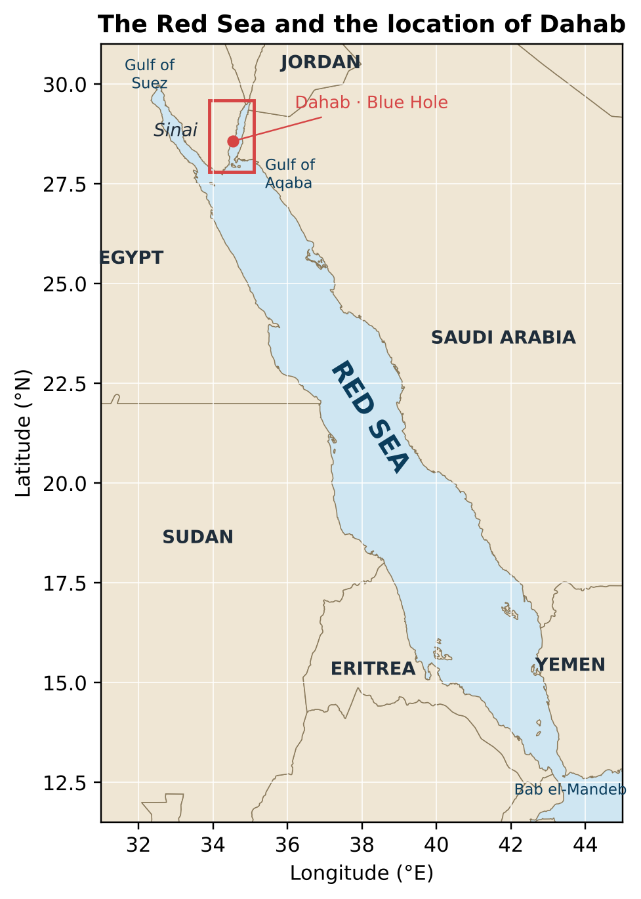
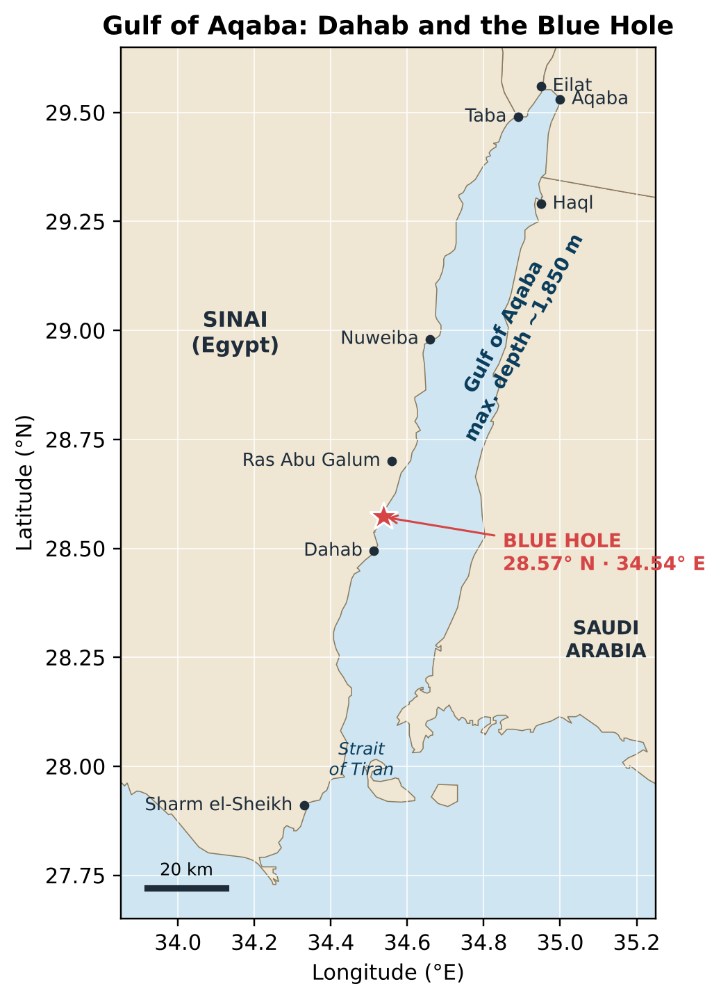
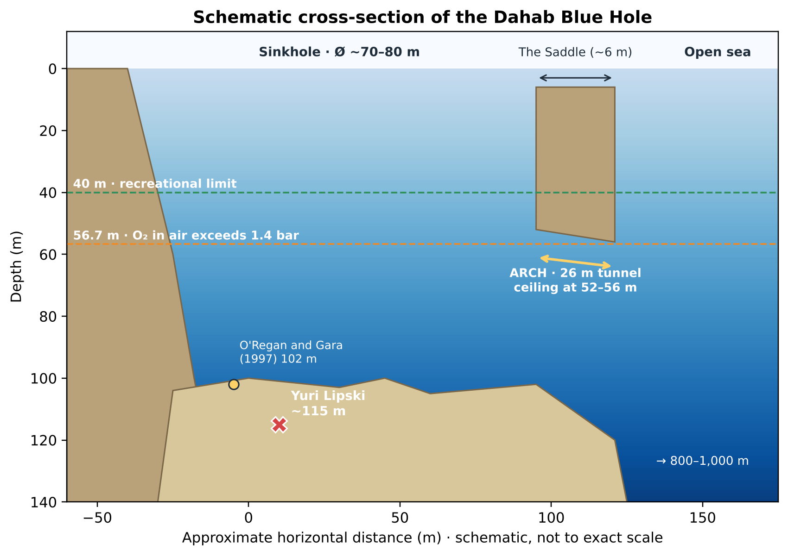
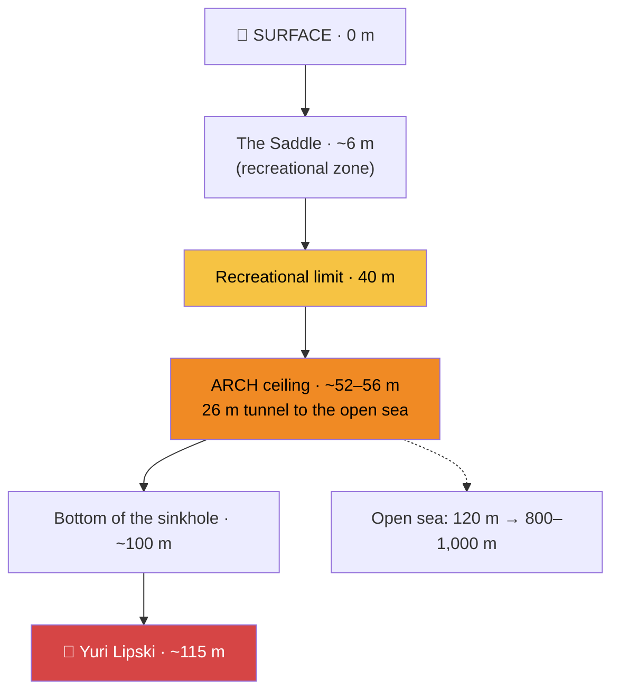
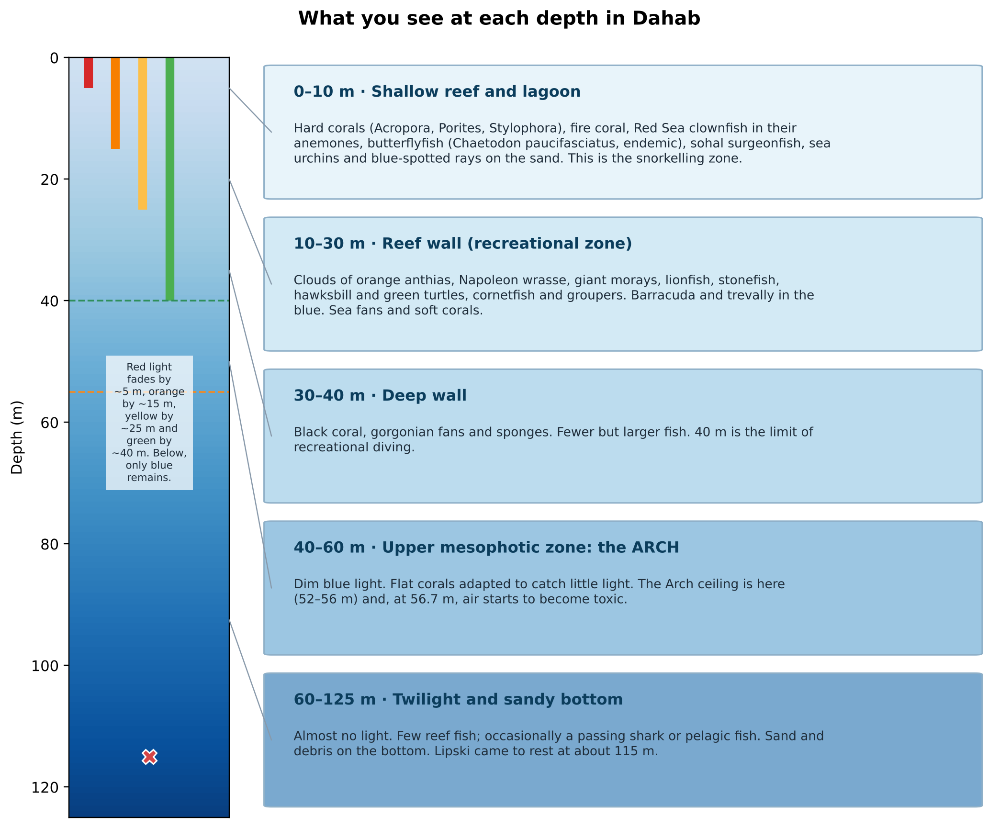
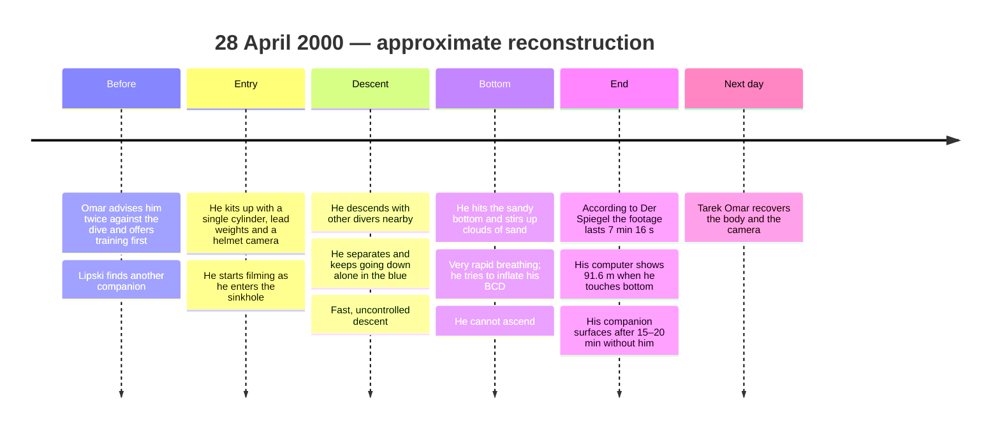
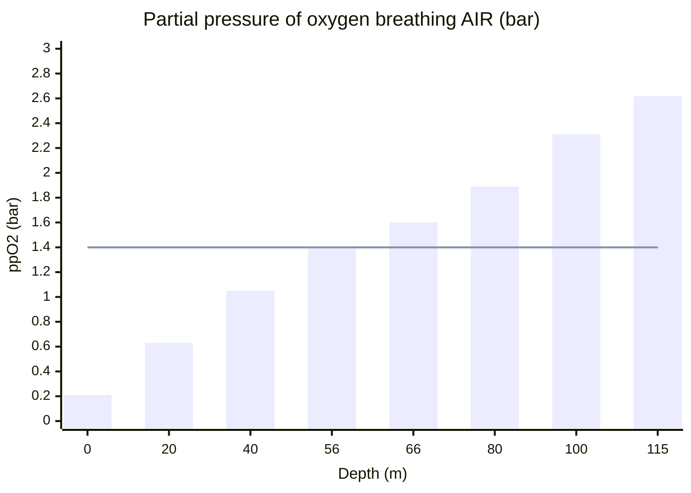
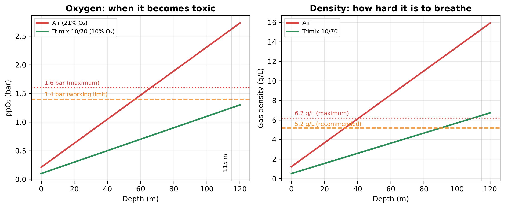
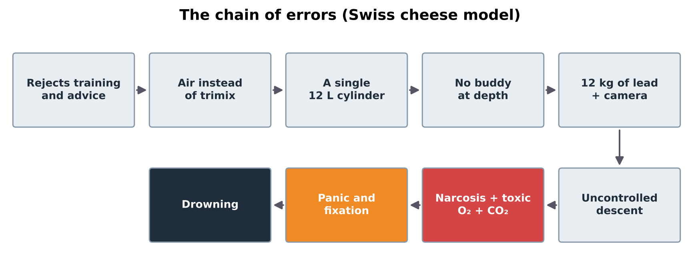
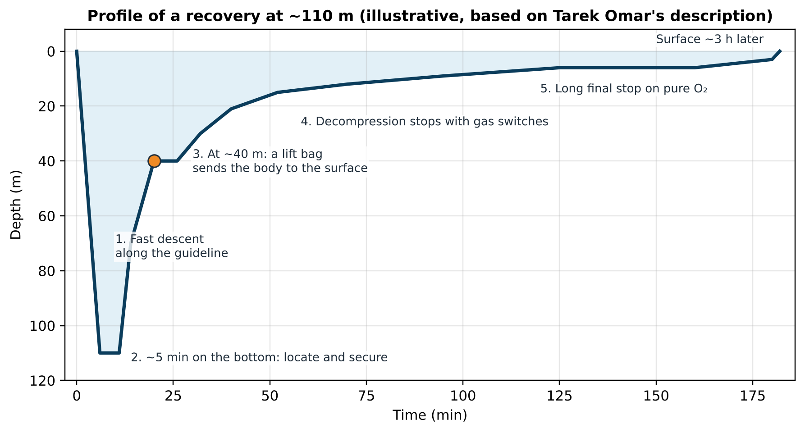

# 🌊 The Yuri Lipski Case and the Dahab Blue Hole

### Physics, physiology and the chain of errors behind a scuba accident at 115 metres

> 🇪🇸 **[Versión en español](README.md)**

> **Popular-science study** · Author: Óscar Ramírez Martín · October 2026
> Based on cross-checked public sources and the author's own calculations.

> 📄 **Full study (extended edition, PDF):** [Study_Yuri_Lipski_Dahab_Blue_Hole.pdf](Study_Yuri_Lipski_Dahab_Blue_Hole.pdf). It also covers the geography of the Red Sea and the Gulf of Aqaba, Dahab's marine life, and a profile of Tarek Omar with his method for recovering bodies.

> ⚠️ **A note of respect.** This study deals with the real death of a 22-year-old man. It does not link to or reproduce the footage of his death and contains no photographs of him. The aim is to understand **why** it happened so that it does not happen again.

*The Blue Hole of Dahab (Egypt). Photo: Gustavo Gerdel, CC BY-SA 4.0, via Wikimedia Commons.*

---

## 📑 Contents

1. [Origin of this study](#1-origin-of-this-study)
2. [The case in 30 seconds](#2-the-case-in-30-seconds)
3. [Who Yuri Lipski was](#3-who-yuri-lipski-was)
4. [The place: the Dahab Blue Hole](#4-the-place-the-dahab-blue-hole)
    - [4.5 What marine life you will find](#45-what-marine-life-you-will-find)
5. [Timeline of the dive](#5-timeline-of-the-dive)
6. [What the footage shows](#6-what-the-footage-shows)
7. [Why he died: a point-by-point analysis](#7-why-he-died-a-point-by-point-analysis)
8. [The chain of errors](#8-the-chain-of-errors)
9. [Recovering the body and the camera](#9-recovering-the-body-and-the-camera)
    - [9.1 Who Tarek Omar is and how he recovers bodies](#91-who-tarek-omar-is-and-how-he-recovers-bodies)
10. [The "divers' cemetery"](#10-the-divers-cemetery)
11. [How the Arch is dived safely](#11-how-the-arch-is-dived-safely)
12. [Myths versus reality](#12-myths-versus-reality)
13. [Cross-checking sources: figures that do not match](#13-cross-checking-sources-figures-that-do-not-match)
14. [Technical glossary](#14-technical-glossary)
15. [Lessons for any diver](#15-lessons-for-any-diver)
16. [Method, limitations and confidence level](#16-method-limitations-and-confidence-level)
17. [Sources](#17-sources)
18. [Image credits](#18-image-credits)

---

## 1. Origin of this study

The starting point was a clip from the Spanish podcast **The Wild Project** (Jordi Wild's channel), published on 30 October 2026 under the title *"He Recorded His Own DEATH Underwater: The Terrifying Case of Yuri Lipski"*. The clip comes from episode #389, a Halloween special on true horror stories with Iván from the **Gran Misterio** channel.

A mystery podcast tells the story for impact. This study does the opposite: it separates what is verified from what is exaggerated, and explains the **physics and physiology** behind the accident, defining every technical term.

---

## 2. The case in 30 seconds

| Fact | Most reliable value |
|---|---|
| **Victim** | Yuri Lipski, 22, Russian-Israeli diving instructor |
| **Date** | 28 April 2000 |
| **Place** | Blue Hole, about 8–10 km north of Dahab (Sinai, Egypt) |
| **Depth where he came to rest** | About 115 m |
| **Breathing gas** | A single 12-litre cylinder of compressed **air** |
| **Usual limit for recreational diving** | 40 m |
| **Why the case is famous** | He wore a helmet camera that filmed the descent and his last minutes |
| **Who recovered the body** | Tarek Omar, a Dahab technical diver, the next day |

**In one sentence:** a young instructor went down alone, on air and with a single cylinder, to almost three times the recreational depth limit. At that depth air becomes narcotic, toxic and hard to breathe all at once, and he could not come back.

---

## 3. Who Yuri Lipski was

- A **22-year-old** diving instructor of Russian origin living in Israel.
- He travelled to Dahab intending to dive the Blue Hole beyond the usual limits.
- According to Tarek Omar, who had met him, Lipski asked him to guide the dive. Omar warned him **twice** not to attempt it and offered to train him first. Lipski declined and found someone else to go with.
- Being an instructor means mastering **basic** equipment. It does **not** mean being trained in deep technical diving, which is a different discipline with its own gases, equipment and procedures (see [§11](#11-how-the-arch-is-dived-safely)).

> 🧠 **Reasoning:** "instructor" ≠ "technical diver". Many Blue Hole accidents involve experienced divers who rely on that experience outside the range they were trained for. Fear holds a novice back; it does not hold back an expert.

---

## 4. The place: the Dahab Blue Hole

 

*Location of Dahab in the Red Sea and the Gulf of Aqaba. Author's own illustrations using Natural Earth coastline data.*

The Blue Hole lies on the east coast of the Sinai Peninsula (Egypt), about 10 km north of Dahab, in the **Gulf of Aqaba**, the north-eastern arm of the Red Sea. The gulf is the southern end of the **Dead Sea Transform fault** and reaches about 1,850 m deep. That is why, a few metres from the shore, the seabed drops vertically.

### 4.1 What a *blue hole* is

A **blue hole** is a **submarine sinkhole**: a vertical shaft in limestone or reef rock. Most formed during the ice ages, when sea level was much lower. Slightly acidic rainwater dissolved the rock and carved out cavities, which flooded when the sea rose again. From above it looks like a dark blue circle ringed by turquoise reef, because deep water absorbs every colour except blue.

### 4.2 Dimensions of the Dahab Blue Hole

*Plan of the Dahab Blue Hole. Author: Usellermann, CC BY-SA 3.0 / GFDL, via Wikimedia Commons.*

| Feature | Size | Notes |
|---|---|---|
| **Diameter** of the opening | ~70–80 m | In the top of the reef |
| **Bottom of the sinkhole** | just over 100 m | Sources give 94 to 130 m |
| **The Saddle** | ~6–7 m | Shallow opening to the open sea, used by recreational divers |
| **The Arch** | ceiling at ~52–56 m | Tunnel through the reef to the open sea |
| **Length of the Arch** | ~26 m | From inside it looks less than 10 m long |
| **Floor of the Arch** | from ~102 m to ~120 m | Slopes down towards the sea side |
| **Outside the Arch** | steps down to ~800–1,000 m | No useful bottom for reference |

*Schematic cross-section of the Blue Hole. Author's own illustration.*

### 4.3 Why the Arch is deceptive

*Technical diver under the Arch of the Blue Hole (2009). Photo: Tommi Salminen, CC BY-SA 3.0, via Wikimedia Commons.*

1. **It is easy to overshoot.** The entrance is not in a straight line from the sinkhole. Divers who miss it keep descending to look for it, and below the Arch there is no bottom to use as a reference.
2. **It looks short.** The water is so clear and the exit so bright that the tunnel seems a few metres long, but it is 26 m.
3. **A current often flows in** from the sea towards the sinkhole. Swimming against it takes more time and more gas.
4. **It is an overhead environment.** Inside it, you cannot ascend vertically (see the [glossary](#14-technical-glossary)).
5. **It sits just past the limit for air.** On air, oxygen becomes dangerous at around 56–57 m (see [§7.3](#73-oxygen-toxicity)), exactly where the ceiling of the Arch is.

### 4.4 A short history of the site

- The Sinai Peninsula was under Israeli control from **1967 to 1979**. During that period the Blue Hole gained an international reputation among divers.
- In **1968**, a group of Israeli divers led by Alex Shell explored it with modern equipment and saw the Arch.
- Since **1982** it has been dived almost every day. The classic recreational dive, *Bells to Blue Hole*, stays above 30 m and ends by crossing the Saddle at 7 m, never going near the Arch.

### 4.5 What marine life you will find

What makes Dahab special is not at the bottom of the sinkhole but on the **reef wall between 0 and 30 m**. Light decides what lives at each depth: water absorbs red first (~5 m), then orange, yellow and green; below ~40 m only blue remains.

| Species | Scientific name | Depth | Did you know? |
|---|---|---|---|
| Anthias | *Pseudanthias squamipinnis* | 3–30 m | Orange clouds over the coral; they are born female and some turn male |
| Napoleon wrasse | *Cheilinus undulatus* | 5–60 m | Can exceed 1.5 m; listed as Endangered by the IUCN |
| Red Sea clownfish | *Amphiprion bicinctus* | 1–30 m | Lives among the tentacles of an anemone |
| Red Sea butterflyfish | *Chaetodon paucifasciatus* | 2–30 m | Endemic (found only in this region) |
| Lionfish / stonefish | *Pterois miles* / *Synanceia verrucosa* | 0–50 m | Venomous: look, don't touch |
| Hawksbill and green turtles | *Eretmochelys imbricata*, *Chelonia mydas* | 1–40 m | Both threatened |
| Garden eels | *Gorgasia sillneri* | 10–40 m | Hundreds of eels poking out of the sand (Eel Garden) |

The corals of the Gulf of Aqaba withstand temperatures that bleach corals in other seas. Their ancestors are thought to have colonised the Red Sea from the south, where the water is very warm, so only the most heat-tolerant survived. The gulf is therefore described as a **thermal refuge** (Fine et al., 2013; Bellworthy and Fine, 2021).

---

## 5. Timeline of the dive

> ⏱️ **Be careful with time figures.** The only verifiable one is the length of the footage (about 7 minutes). The other times come from indirect accounts.

---

## 6. What the footage shows

*(Description based on written sources that analyse it. This study does not link to the video.)*

1. **First minutes:** reef walls, other divers, bright blue light.
2. **Separation:** the others disappear from view and only blue water remains. The light fades.
3. **Continuous descent:** there is no visible stop to control buoyancy.
4. **Reaching the bottom:** sand is stirred up and clouds the image. His breathing grows faster and faster.
5. **Final phase:** signs of struggle and attempts to inflate the BCD. According to Wikipedia's description, he even **removes the regulator** from his mouth. The camera ends up facing the bottom and the image goes still.

> 🔍 **Important nuance:** several sources point out that the tape **does not literally show the moment of death**, only the minutes before it. The title "he filmed his own death" is therefore a simplification.

---

## 7. Why he died: a point-by-point analysis

Nobody can know for certain what was going through his mind. But diving physics lets us calculate **what the air was doing to him at 115 m**. The numbers in this section are the author's own calculations, made with standard formulas and checked with a script.

### 7.1 Pressure (Boyle's law)

In the sea, every **10 m** of depth adds **1 bar** of pressure, on top of 1 bar from the atmosphere.

$$P_{\text{absolute}} = 1 + \frac{\text{depth (m)}}{10}$$

| Depth | Absolute pressure | One litre of surface air takes up… |
|---|---|---|
| 0 m | 1 bar | 1 L |
| 10 m | 2 bar | 0.5 L |
| 40 m | 5 bar | 0.2 L |
| 56 m | 6.6 bar | 0.15 L |
| **115 m** | **12.5 bar** | **0.08 L** |

**Consequence:** at 115 m every gas is compressed 12.5 times. This affects three things at once: **gas consumption** ([§7.5](#75-gas-consumption-the-cylinder-empties-12-times-faster)), the **BCD** ([§7.6](#76-buoyancy-why-he-could-not-ascend)) and the **neoprene** of the wetsuit.

### 7.2 Nitrogen narcosis ("rapture of the deep")

Air is **79% nitrogen**. Under **Dalton's law**, each gas in a mixture contributes its share of the total pressure (its **partial pressure**). Under **Henry's law**, the higher that partial pressure, the more gas dissolves in the blood and tissues.

Nitrogen dissolved at high pressure has an **anaesthetic** effect on the nervous system. The effects resemble alcohol: euphoria, overconfidence, fixation, slowness and, at great depth, hallucinations and loss of consciousness.

- An informal rule, **"Martini's law"**, compares every 10 m below 20 m to drinking one martini.
- At 115 m: (115 − 20) / 10 ≈ **9–10 "martinis"**.
- Partial pressure of nitrogen at 115 m: 0.79 × 12.5 ≈ **9.9 bar**, versus 0.79 bar at the surface.

> 🧠 **Why it matters:** narcosis **does not hurt or warn you**. It removes exactly the ability to notice the danger. The only remedy is to **ascend**, and ascending was what Lipski could not do.

### 7.3 Oxygen toxicity

Oxygen, essential for life, is **toxic** to the central nervous system when its partial pressure (**ppO₂**) is too high. It can cause **convulsions without warning**. Underwater, a convulsion usually makes the diver lose the regulator and drown.

- Recommended working limit: **1.4 bar**. Maximum contingency limit: **1.6 bar**.
- The ppO₂ of air at 115 m is 0.21 × 12.5 ≈ **2.6 bar**, **almost twice the maximum**.
- **Maximum operating depth (MOD)** of air:
  - at 1.4 bar → 10 × (1.4 / 0.21 − 1) ≈ **56.7 m**
  - at 1.6 bar → ≈ **66 m**

> 💡 **Telling detail:** *Der Spiegel* (2012) puts the critical limit for compressed air at **56 m**, and the ceiling of the Arch is between 52 and 56 m. The calculation confirms it: **the Arch is exactly where air starts to turn into poison.** Lipski was about 60 m deeper.

*Bars: ppO₂ of air at each depth. Line: recommended limit of 1.4 bar.*

*Partial pressure of oxygen and gas density breathing air or trimix 10/70. Author's own calculation.*

### 7.4 Gas density and carbon dioxide (CO₂)

This factor is rarely mentioned in mystery videos, but it is one of the most important. At 12.5 bar, air is **12.5 times denser**: about **15 g/L**, versus 1.2 g/L at the surface.

- The recommendations of Anthony and Mitchell (2016) set a preferred maximum of **5.2 g/L** and an absolute maximum of **6.2 g/L**. On air, those limits are reached at about **32 m** and **41 m**.
- At 115 m, the density is **2.5 times the absolute maximum**.
- Such a dense gas flows poorly through the airways. It takes great effort to move, and **CO₂ builds up** (**hypercapnia**).
- Excess CO₂ causes **breathlessness and anxiety**, **intensifies narcosis** and **makes oxygen toxicity more likely**.

> 🔄 **The vicious circle:** dense gas → CO₂ builds up → breathlessness and panic → faster breathing → more CO₂ and more gas used → more panic. This fits the breathing described by those who have analysed the footage.

### 7.5 Gas consumption: the cylinder empties 12 times faster

| Situation | Surface consumption (SAC) | Consumption at 115 m | Duration of a 12 L cylinder at 200 bar (2,400 L) |
|---|---|---|---|
| Relaxed diver | 20 L/min | 250 L/min | **≈ 9.6 min** |
| Effort or stress | 40 L/min | 500 L/min | **≈ 4.8 min** |
| Panic | 60 L/min | 750 L/min | **≈ 3.2 min** |

*Author's estimate. His actual cylinder pressure and personal consumption are not recorded in any source.*

**Conclusion:** even starting with a full cylinder, there was not enough gas for the **decompression stops** such a dive requires, nor even for a slow ascent.

### 7.6 Buoyancy: why he could not ascend

According to Wikipedia, he tried to inflate his BCD but could not rise. Several physical factors worked against him:

1. **Too much lead.** Omar told *Der Spiegel* he wore about **12 kg of lead** on his belt, plus the 12-litre cylinder, the camera and the batteries.
2. **Neoprene gets crushed.** A wetsuit floats thanks to gas bubbles inside it. At 12.5 bar those bubbles are compressed and the suit loses almost all its buoyancy, so the diver weighs much more than at the surface.
3. **Inflating the BCD takes a lot of gas.** Offsetting 12 kg requires 12 L of gas **at 115 m**, which is about **150 surface litres** taken from a cylinder that was already emptying fast.
4. **A procedural error driven by narcosis.** According to Omar, the BCD burst because it was already full when Lipski tried to pump more air into it, instead of dropping his weight belt. Under narcosis and panic it is typical to **fixate on a single action**.

> ⚖️ **Beware the opposite trap:** had he dropped his weights, he would have shot up uncontrollably from 115 m, very probably suffering severe **decompression sickness** or **pulmonary barotrauma**. At that depth, with that equipment, **there was no safe way out**. The decisive error was made **before** he entered the water.

### 7.7 The human factor

- **Alone:** no buddy to hold him, share gas or bring him up.
- **In a hurry:** he turned down the training he was offered because he did not want to wait.
- **Target fixation:** the site's fame pushes people to want to "get" the dive.
- **Overconfidence:** being an instructor made him feel safe on ground that was not his.

---

## 8. The chain of errors

Safety science uses the **Swiss cheese model**: an accident rarely has a single cause. It happens when the holes in several layers of protection line up.

| Link | Verified? | Confidence |
|---|---|---|
| He rejected the advice of an expert | Yes (Omar in *The Guardian* and *CairoScene*) | 0.9 |
| He breathed air from a single 12 L cylinder | Yes (Omar in *Der Spiegel*; Wikipedia assumes it) | 0.85 |
| Uncontrolled descent to ~115 m | Yes (footage and depth of the body) | 0.9 |
| About 12 kg of lead | Direct testimony from Omar in *Der Spiegel* | 0.8 |
| Severe narcosis | Physically unavoidable at that depth | 0.95 |
| Oxygen toxicity as a direct cause | Possible (Omar's view); cannot be proven | 0.55 |
| CO₂ build-up | Very likely given the gas density | 0.8 |

---

## 9. Recovering the body and the camera

- **Tarek Omar**, a Bedouin technical diver who has lived in Dahab since 1989, recovered the body **the next day** at the family's request.
- Next to the body he found the **camera**. It was rated to **75 m** and had been at 115 m, yet it **still worked**.
- When the mother asked for help taking the equipment apart, they played the tape in her presence. Omar later said that, had he known the footage existed, he would have destroyed it, because he regrets that the mother will forever have images of her son dying.
- The footage ended up online. In 2014, *Atlas Obscura* reported that it had over **8 million views**.

> 🧭 **Ethical note:** the footage has training value for divers, but it is also the real death of someone with a family. That is why this study does not link to it.

### 9.1 Who Tarek Omar is and how he recovers bodies

> In The Wild Project video he is presented as Lipski's dive buddy, but **he did not dive with him**: he advised him twice against the dive and, the next day, went down to recover his body.

| Aspect | Fact |
|---|---|
| Origin | Bedouin of the Aulad Ali tribe, born around 1965–66 near the Libyan border |
| In Dahab | Arrived in 1989; learned to dive in 1992; instructor since 1995 |
| First recoveries | 1997: Conor O'Regan and Martin Gara, found in each other's arms at 102 m |
| Local depth record | 209 m (*Der Spiegel*) or 220 m (*Al-Masry Al-Youm*) |
| Nicknames | "Sheikh of the divers", "King of the Blue Hole", "the bone collector" |
| School | Opened the first technical diving centre in Dahab |
| Fee | He charges nothing; he only asks for the cost of the gas |

**His method, as he described it to *Der Spiegel* (2012):**

1. He finds out what equipment the dead diver had (wetsuit, lead) to estimate how the body sank.
2. He asks the buddy where and at what depth the diver was last seen.
3. His team warns the swimmers on site.
4. He descends and lets himself drift as a lifeless body would.
5. Most bodies lie between 100 and 120 m. He holds the body or ties it to himself: he has about **5 minutes** on the bottom.
6. He ascends with it to ~40 m and sends it to the surface with a **lift bag** (the dead diver needs no decompression).
7. He stays down for up to **~3 hours** doing decompression stops, breathing **trimix** and decompression gases.

**How it should be done according to best practice:** first decide whether the risk is worth it (never create more victims); use a team with support divers at the stops; carry gas with reserves; search methodically from the last known point; size the lift bag and release it away from the diver; keep a cutter at hand against entanglement; and have a hyperbaric chamber ready. The hardest lesson is the case of **Dave Shaw** (South Africa, 2005): he died at 270 m trying to recover another diver, entangled in lines and exhausted by the effort of breathing very dense gas. All of this is covered in detail in the PDF.

---

## 10. The "divers' cemetery"

*Plaques in memory of divers who died, next to the Blue Hole (2011). Photo: D T G, CC BY 3.0, via Wikimedia Commons.*

### 10.1 How many have died?

**There is no official record.** Published figures vary widely:

| Source | Figure | Period |
|---|---|---|
| Tarek Omar in *Der Spiegel* (2012) | **more than 130** | 1997–2012 (about 8 a year) |
| Local community and travel press | up to **200** | "in recent years" |
| *Undercurrent* (2017) | **at least 40** scuba divers | since 1980 |
| Plaques on the shore (2012) | **14** plaques | Only victims with a plaque |

> 🧠 **Reasoning:** the higher figures probably also include deaths of **snorkellers** from causes unrelated to the Arch, which Wikipedia mentions. The prudent statement is "**more than a hundred, with no official figure**".

### 10.2 Other documented cases

- **Conor O'Regan and Martin Gara** (Ireland), aged 22 and 23, died on 19 November 1997. Omar found the bodies **in each other's arms at 102 m**. His explanation: one began to sink, the other went down to help, and both lost consciousness. They were Omar's first recoveries.
- Other plaques mentioned by *Der Spiegel*: "James" (2003, 135 m) and "Andrei" (2004; equipment that may have been his was seen at 170 m).
- In 2011, **Igor Shalo**, a technical diver with about 400 dives, went down to 150 m with little decompression experience, got into breathing trouble at 130 m and ascended without stopping. He died on his 401st dive.
- **Stephen Keenan** (Ireland, 39), a **freediving** safety diver, died on **22 July 2017**. He was supporting Italian champion **Alessia Zecchini** in an attempt to swim through the Arch on a single breath. She became disoriented, he reached the meeting point late, rescued her and pushed her to the surface, but did not survive himself. His story is told in the Netflix documentary ***The Deepest Breath*** (2023).

### 10.3 Measures taken

- The Egyptian Chamber of Diving and Water Sports stations a **police officer** at the Blue Hole to check that divers are with a certified guide.
- Local centres require at least a **Tech 60** certification (technical diving to 60 m) to attempt the Arch.
- Even so, *Der Spiegel* reported in 2012 that some guides would take people into the tunnel **with no questions asked for about €100**.

---

## 11. How the Arch is dived safely

*Technical diver on trimix on a wreck at 108 m (Toulon, France). This is how divers equip for such depths. Photo: Reginestein / Alexandre Hache, CC BY-SA 3.0, via Wikimedia Commons.*

| What Lipski did | What a technical diver does |
|---|---|
| Air (21% O₂, 79% N₂) | **Trimix** (O₂ + helium + N₂): less nitrogen to reduce narcosis and less oxygen to avoid toxicity |
| A single cylinder | **Twin back-mounted cylinders** plus **stage** and **decompression** cylinders |
| No gas plan | **Gas planning** with reserves (rule of thirds) |
| Alone | **A team of divers** with an agreed plan and signals |
| Free descent in the blue | **Controlled** descent with a **guideline** and depth reference |
| No decompression | **Decompression stops** planned with a computer or tables |
| Recreational certification | Technical certification (**Tech 60** or higher) and progressive experience |

### Air versus trimix at 115 m (author's calculation)

| Parameter at 115 m | Air | Trimix 10/70 | Comment |
|---|---|---|---|
| ppO₂ | 2.62 bar | 1.25 bar | Trimix stays below 1.4 bar |
| Equivalent narcotic depth (END) | 115 m | ~22 m | On trimix, narcosis is like being at ~22 m on air |
| Gas density | 15.3 g/L | ~6.5 g/L | Even trimix is at the limit, which is why deeper dives use more helium or rebreathers |

> Wikipedia notes that, for a well-equipped and competent technical diver, the Arch presents **little difficulty**. The site is not deadly in itself: what kills is diving it **without the right training and equipment**.

*Jacket-style buoyancy compensator, the piece of equipment Lipski was trying to inflate. Photo: Mark.murphy, public domain, via Wikimedia Commons.*

---

## 12. Myths versus reality

| Myth | Reality | Confidence |
|---|---|---|
| "There is something supernatural about the Blue Hole" | Omar denies it: the causes are human and physical | 0.95 |
| "Tarek was his dive buddy" | He did not dive with him: he advised against the dive and later recovered the body | 0.9 |
| "He filmed the exact moment of his death" | He filmed the descent and his last minutes; the final instant is not clearly visible | 0.7 |
| "He was a beginner" | He was an instructor, but not a technical diver | 0.9 |
| "He simply ran out of oxygen" | Most likely a combination of narcosis, CO₂, oxygen toxicity, too much lead and panic | 0.75 |
| "He was carrying an oxygen tank" | He was breathing compressed **air**. Pure oxygen would be lethal at that depth | 0.85 |
| "The Blue Hole is the most dangerous place in the world" | The sinkhole is an ordinary dive site; the danger is the **Arch** below 50 m | 0.9 |
| "200 people have died there" | There is no official record; estimates range from 40 to 200 depending on period and criteria | 0.8 |
| "An eel attacks him at the end of the video" (theory posted on GitHub in 2019) | Unconfirmed. It rests on interpreting a very dark image and is probably **pareidolia** (seeing familiar shapes in random patterns). No serious source supports it | 0.9 that it is false |

---

## 13. Cross-checking sources: figures that do not match

| Fact | Version A | Version B | Most likely and why |
|---|---|---|---|
| **Date** | 28 April 2000 (Wikipedia, plaque cited by *Der Spiegel*) | 8 April 2000 (blog *A Little Bit Human*) | **28 April**: the primary source and the plaque agree |
| **Depth** | 115 m (body, Omar in *Der Spiegel*, Wikipedia) | 91.6 m (computer in the video); 111 m; "just over 300 feet" (*Atlas Obscura*) | He touched bottom at ~92 m; the body was found at **~115 m** |
| **Ceiling of the Arch** | 52 m (*Der Spiegel*) | 55–56 m (Wikipedia, *DeeperBlue*) | **52–56 m**, depending on where it is measured |
| **Depth of the sinkhole** | ~100 m (Wikipedia) | 94 / 110 / 120 / 130 m (travel sites) | **~100 m** inside the sinkhole; much deeper beyond the Arch |
| **Who asked for the recovery** | The mother (Wikipedia, Omar) | The father (*A Little Bit Human*) | **The mother** asked; the father later thanked Omar |
| **When he was recovered** | The next day (Wikipedia) | About two days later (blog) | **The next day**, according to Omar |
| **Total deaths** | more than 130 in 15 years | up to 200 / at least 40 | **More than 100, no official figure** |

---

## 14. Technical glossary

| Term | Meaning |
|---|---|
| **Arch** | ~26 m tunnel connecting the Blue Hole with the open sea, with its ceiling at ~52–56 m |
| **bar** | Unit of pressure. 1 bar ≈ atmospheric pressure at sea level |
| **BCD** (buoyancy compensator, jacket, wing) | Vest inflated with gas from the cylinder to adjust buoyancy |
| **Blue hole** | Submarine sinkhole: a vertical shaft in limestone or reef rock, flooded when sea level rose |
| **Boyle's law** | At constant temperature, the volume of a gas is inversely proportional to its pressure |
| **CO₂ / hypercapnia** | Too much carbon dioxide in the blood. Causes breathlessness, anxiety, confusion and eventually loss of consciousness |
| **Dalton's law** | The total pressure of a gas mixture is the sum of the partial pressures of each gas |
| **Decompression (stops)** | Stops during the ascent so that gas dissolved in the tissues leaves gradually without forming bubbles |
| **Decompression sickness** (DCS, the bends) | Injury caused by gas bubbles in blood and tissues after ascending too fast |
| **END** | Equivalent narcotic depth: the depth on air that would produce the same narcosis as a given mix |
| **Freediving** | Diving on a single held breath, without a cylinder |
| **Gas density** | Mass per litre of breathing gas (g/L). It rises with depth and makes breathing harder |
| **Heliox** | A mix of helium and oxygen, with no nitrogen |
| **Helium** | Inert, light gas with almost no narcotic effect. Replaces nitrogen in deep mixes |
| **Henry's law** | The amount of gas dissolved in a liquid is proportional to its partial pressure |
| **Inflator** | Valve that feeds gas from the cylinder into the BCD |
| **Lift bag** | Bag filled with gas underwater to raise objects or bodies |
| **"Martini's law"** | Informal rule: narcosis equals one martini for every 10 m below 20 m |
| **MOD** (maximum operating depth) | Depth beyond which the ppO₂ of a mix exceeds the safe limit |
| **Neoprene** | Wetsuit material containing gas bubbles for buoyancy and insulation; it compresses with depth |
| **Nitrogen narcosis** | Anaesthetic effect of nitrogen at high pressure. Similar to drunkenness; it disappears on ascent |
| **Nitrox** | Air enriched with more than 21% oxygen. Useful at moderate depths, not at 115 m |
| **Overhead environment** | A place where you cannot ascend vertically: caves, wrecks, tunnels |
| **Oxygen toxicity (CNS)** | Toxic effect of O₂ on the central nervous system above ~1.4–1.6 bar. It can cause convulsions |
| **Pareidolia** | The brain's tendency to see familiar shapes (faces, animals) in blurry or random images |
| **Partial pressure** (ppO₂, ppN₂) | The share of the total pressure due to a given gas in the mix |
| **Pulmonary barotrauma** | Lung rupture caused by ascending while holding your breath: the gas expands as pressure drops |
| **Recreational diving** | Sport diving without mandatory decompression stops, usually to a maximum of 40 m |
| **Regulator** | Device that reduces cylinder pressure to ambient pressure so you can breathe |
| **SAC** (surface air consumption) | Gas consumption per minute expressed in surface litres |
| **Saddle** | Shallow opening (~6 m) from the Blue Hole to the sea, used on recreational dives |
| **Sinkhole** | Depression or shaft formed by the dissolution of limestone |
| **Stage cylinder** | Extra cylinder clipped to the technical diver's side, with gas for a specific phase of the dive |
| **Tech 60** | Technical diving certification level for dives to 60 m |
| **Technical diving** | Diving beyond recreational limits: deeper than 40 m, special gases, mandatory decompression or overhead environments |
| **Trimix** | A mix of oxygen, helium and nitrogen for deep dives |

---

## 15. Lessons for any diver

1. **Dive within your training**, not your ego. Being a recreational instructor does not make you a technical diver.
2. **Never go deep alone**, least of all in an overhead environment or where there is no bottom.
3. **Air has limits**: because of oxygen toxicity, at around 56–66 m; because of gas density, already at around 32–41 m.
4. **Narcosis gives no warning.** If something feels wrong, **ascend a few metres**.
5. **Weight yourself correctly.** With too much lead, any buoyancy problem becomes an emergency.
6. **Listen to local experts.** Lipski was warned twice.
7. **Plan your gas** with reserves for the unexpected.
8. **A site's fame is not a reason to dive it.**

---

## 16. Method, limitations and confidence level

**How the study was done:**

1. The case was broken down into parts: facts, place, physics, physiology, recovery, context and myths.
2. Every fact was checked against at least two independent sources wherever possible. Discrepancies are listed in [§13](#13-cross-checking-sources-figures-that-do-not-match).
3. The calculations (pressure, ppO₂, MOD, END, density, consumption, buoyancy) use standard formulas and were checked with a Python script.
4. All the text is original writing: no paragraphs are copied from any source, and sources are cited at the end.
5. **Originality check (31/10/2026):** exact phrases from the study and similar analyses were searched for online, with no matches. On GitHub there is only a short 2019 note in English (`shawwn/yuri`) with the speculative eel theory.

**Limitations:**

- Neither The Wild Project video nor the original footage could be viewed. The description comes from written sources.
- The exact cause of death is **not known for certain**. No autopsy has been published.
- The consumption figures are **estimates**: his personal consumption and the actual cylinder pressure are unknown.

**Overall confidence:**

| Block | Confidence |
|---|---|
| Basic facts (who, when, where, depth) | 0.9 |
| Physics and physiology (calculations) | 0.95 |
| Reconstruction of the exact sequence | 0.65 |
| Specific cause of death | 0.6 (multifactorial and probable, unconfirmed) |
| Biography of Tarek Omar | 0.75 |
| Blue Hole death toll | 0.5 (no official record) |

---

## 17. Sources

**Main sources**

- Wikipedia. *Blue Hole (Red Sea)*. https://en.wikipedia.org/wiki/Blue_Hole_(Red_Sea)
- Grossekathöfer, M. (13/07/2012). *The Blue Hole in the Red Sea Is the Deadliest Dive Site in the World*. **Der Spiegel International**. https://www.spiegel.de/international/zeitgeist/the-blue-hole-in-the-red-sea-is-the-deadliest-dive-site-in-the-world-a-844099.html
- Ghoneim, N. (20/10/2016). *Egyptian Diver Tarek Omar: The Keeper of Dahab's Divers' Cemetery*. **CairoScene**. https://cairoscene.com/lifestyle/egyptian-diver-tarek-omar-the-keeper-of-dahab-s-divers-cemetery
- Bower, E. (26/08/2017). *Top diver's death casts long shadow over deep beauty of the Blue Hole*. **The Guardian**. https://www.theguardian.com/world/2017/aug/26/blue-hole-red-sea-diver-death-stephen-keenan-dahab-egypt
- *Atlas Obscura* / Slate (04/03/2014). *Diver's cemetery: the Blue Hole of Dahab*. https://www.slate.com/blogs/atlas_obscura/2014/03/04/diver_s_cemetery_the_blue_hole_of_dahab_on_the_red_sea_in_egypt.html
- Al-Masry Al-Youm (2016) and Masrawy (2018): reports on Tarek Omar (in Arabic).

**Place and marine life**

- Wikipedia. *Red Sea*, *Gulf of Aqaba*, *Dahab*.
- Bellworthy, J. and Fine, M. (2021). *Warming resistant corals from the Gulf of Aqaba live close to their cold-water bleaching threshold*. PeerJ. https://pmc.ncbi.nlm.nih.gov/articles/PMC8005291/
- UNESCO. *Coral Reefs of the Gulf of Aqaba and the Red Sea in the Kingdom of Saudi Arabia* (tentative list, 2024). https://whc.unesco.org/en/tentativelists/6701/

**Diving physics and physiology**

- Wikipedia. *Nitrogen narcosis*. https://en.wikipedia.org/wiki/Nitrogen_narcosis
- WorkSafe New Zealand. *Breathing oxygen and enriched mixtures while diving*. https://www.worksafe.govt.nz/about-us/news-and-media/breathing-oxygen-and-enriched-mixtures-while-diving/
- TDI. *Avoid CNS Oxygen Toxicity While Diving Nitrox*. https://www.tdisdi.com/tdi-diver-news/avoid-cns-oxygen-toxicity-while-diving-nitrox/
- DDRC Healthcare. *Gas Density and SCUBA* (summarising Anthony and Mitchell, 2016). https://www.ddrc.org/gas-density-and-scuba/
- DAN. *Gas density for divers*. https://dan.org/?p=12020

**Context and other cases**

- Wikipedia. *Stephen Keenan*, *Dave Shaw*.
- DeeperBlue. *Freediver Stephen Keenan dies providing safety at Dahab Blue Hole*. https://www.deeperblue.com/freediver-stephen-keenan-dies-providing-safety-dahab-blue-hole
- Undercurrent (2017). *Dangerous dive site*. https://undercurrent.org/UCnow/dive_magazine/2017/DangerousDiveSite201709.html
- Showcaves.com. *Blue Hole, Dahab*. https://showcaves.com/english/eg/karst/Blue.html

**Origin**

- The Wild Project. *He Recorded His Own DEATH Underwater: The Terrifying Case of Yuri Lipski* (30/10/2026). https://www.youtube.com/watch?v=qArQMyX28PA

---

## 18. Image credits

All photographs come from **Wikimedia Commons** and carry free licences that allow reuse with attribution.

| Image | Author | Licence | Original page |
|---|---|---|---|
| View of the Blue Hole | Gustavo Gerdel (2018) | CC BY-SA 4.0 | [Commons](https://commons.wikimedia.org/wiki/File:Dahab_Blue_Hole.jpg) |
| Plan of the Blue Hole | Usellermann (2009) | CC BY-SA 3.0 / GFDL | [Commons](https://commons.wikimedia.org/wiki/File:Blue_Hole_map.png) |
| Diver under the Arch | Tommi Salminen (2009) | CC BY-SA 3.0 | [Commons](https://commons.wikimedia.org/wiki/File:Dahab_Blue_Hole_Arc_2009.jpg) |
| Memorial plaques | D T G (2011) | CC BY 3.0 | [Commons](https://commons.wikimedia.org/wiki/File:EGYPT_Dahab_Blue_Hole_memorials.JPG) |
| Trimix diver | Reginestein / Alexandre Hache (2021) | CC BY-SA 3.0 | [Commons](https://commons.wikimedia.org/wiki/File:Plongeur_Trimix.jpg) |
| Buoyancy compensator | Mark.murphy (2004) | Public domain | [Commons](https://commons.wikimedia.org/wiki/File:Bcd_-_stab.JPG) |
| Maps, cross-section, depth zones, charts and diagrams (`figs_en/`) | Óscar Ramírez Martín | CC BY-SA 4.0 | Author's own work; coastlines from Natural Earth (public domain) |

> **Licence of this document:** original text and diagrams under **CC BY-SA 4.0** (required by the CC BY-SA photos it includes). Each photograph keeps its author's licence.

---

*In memory of those who never came back from the Blue Hole.*
