# 🌊 El caso Yuri Lipski y el Blue Hole de Dahab

### Física, fisiología y cadena de errores de un accidente de buceo a 115 metros

> **Estudio divulgativo** · Autor: Óscar Ramírez Martín · Octubre 2026
> Elaborado a partir de fuentes públicas contrastadas y de cálculos propios.

> 📄 **Estudio completo (edición ampliada, 32 páginas):** [Estudio_Yuri_Lipski_Blue_Hole_Dahab.pdf](Estudio_Yuri_Lipski_Blue_Hole_Dahab.pdf). Incluye además la geografía del mar Rojo y del golfo de Aqaba, la vida marina de Dahab y la biografía de Tarek Omar con su método de recuperación de cuerpos.

> ⚠️ **Nota de respeto.** Este estudio trata la muerte real de una persona de 22 años. No enlaza ni reproduce la grabación de su muerte y no incluye fotografías suyas. El objetivo es entender **por qué** ocurrió, para que no vuelva a ocurrir.

*El Blue Hole de Dahab (Egipto). Foto: Gustavo Gerdel, CC BY-SA 4.0, vía Wikimedia Commons.*

---

## 📑 Índice

1. [Origen de este estudio](#1-origen-de-este-estudio)
2. [El caso en 30 segundos](#2-el-caso-en-30-segundos)
3. [Quién era Yuri Lipski](#3-quién-era-yuri-lipski)
4. [El lugar: el Blue Hole de Dahab](#4-el-lugar-el-blue-hole-de-dahab)
    - [4.5 Qué vida marina encontramos](#45-qué-vida-marina-encontramos)
5. [Cronología de la inmersión](#5-cronología-de-la-inmersión)
6. [Qué muestra la grabación](#6-qué-muestra-la-grabación)
7. [Por qué murió: análisis punto por punto](#7-por-qué-murió-análisis-punto-por-punto)
8. [La cadena de errores](#8-la-cadena-de-errores)
9. [La recuperación del cuerpo y de la cámara](#9-la-recuperación-del-cuerpo-y-de-la-cámara)
    - [9.1 Quién es Tarek Omar y cómo recupera los cuerpos](#91-quién-es-tarek-omar-y-cómo-recupera-los-cuerpos)
10. [El «cementerio de buceadores»](#10-el-cementerio-de-buceadores)
11. [Cómo se bucea el Arco de forma segura](#11-cómo-se-bucea-el-arco-de-forma-segura)
12. [Mitos frente a realidad](#12-mitos-frente-a-realidad)
13. [Contraste de fuentes: datos que no coinciden](#13-contraste-de-fuentes-datos-que-no-coinciden)
14. [Glosario técnico](#14-glosario-técnico)
15. [Lecciones para cualquier buceador](#15-lecciones-para-cualquier-buceador)
16. [Metodología, límites y nivel de confianza](#16-metodología-límites-y-nivel-de-confianza)
17. [Fuentes](#17-fuentes)
18. [Créditos de las imágenes](#18-créditos-de-las-imágenes)

---

## 1. Origen de este estudio

El punto de partida fue un clip del pódcast **The Wild Project** (canal de Jordi Wild), publicado el 30 de octubre de 2026 con el título *"He Recorded His Own DEATH Underwater: The Terrifying Case of Yuri Lipski"*. El clip pertenece al episodio #389, un especial de Halloween sobre casos reales de terror con Iván, del canal **Gran Misterio**.

Un pódcast de misterio cuenta la historia buscando impacto. Este estudio hace lo contrario: separa lo comprobado de lo exagerado y explica la **física y la fisiología** que hay detrás, con cada término técnico definido.

---

## 2. El caso en 30 segundos

| Dato | Valor más fiable |
|---|---|
| **Víctima** | Yuri Lipski, 22 años, instructor de buceo ruso-israelí |
| **Fecha** | 28 de abril de 2000 |
| **Lugar** | Blue Hole, unos 8–10 km al norte de Dahab (Sinaí, Egipto) |
| **Profundidad donde quedó** | Unos 115 m |
| **Gas respirado** | Una sola botella, que se supone de **aire** comprimido |
| **Límite habitual del buceo recreativo** | 40 m |
| **Lo que lo hace famoso** | Llevaba una cámara de vídeo en el casco que grabó el descenso y sus últimos minutos |
| **Quién recuperó el cuerpo** | Tarek Omar, buceador técnico de Dahab, al día siguiente |

**En una frase:** un instructor joven bajó solo, con aire y una única botella, a casi el triple de la profundidad recreativa. A esa profundidad el aire se vuelve narcótico, tóxico y difícil de respirar al mismo tiempo, y ya no pudo volver.

---

## 3. Quién era Yuri Lipski

- Instructor de buceo de **22 años**, de origen ruso y residente en Israel.
- Viajó a Dahab con la intención de bucear el Blue Hole más allá de lo habitual.
- Según Tarek Omar, que lo había conocido, Lipski le pidió que lo guiara. Omar le advirtió **dos veces** que no lo intentara y le propuso entrenar con él antes. Lipski no aceptó y buscó otro acompañante.
- Ser instructor significa dominar el equipo **básico**. **No** significa estar formado en buceo técnico profundo, que es una disciplina distinta, con gases, equipos y procedimientos propios (ver [§11](#11-cómo-se-bucea-el-arco-de-forma-segura)).

> 🧠 **Razonamiento:** «instructor» ≠ «buceador técnico». Muchos accidentes del Blue Hole los sufren buceadores con experiencia que confían en ella fuera de su rango de formación. Al buceador novato le frena el miedo; al experto, no.

---

## 4. El lugar: el Blue Hole de Dahab

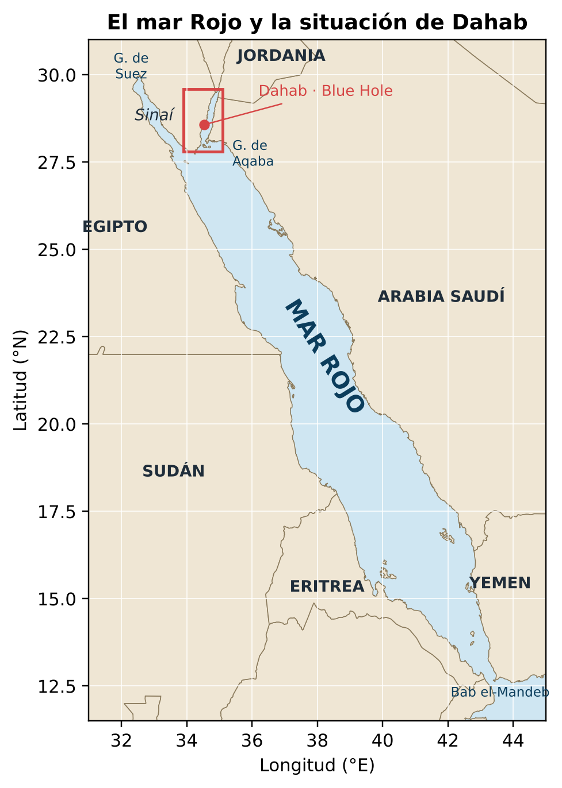 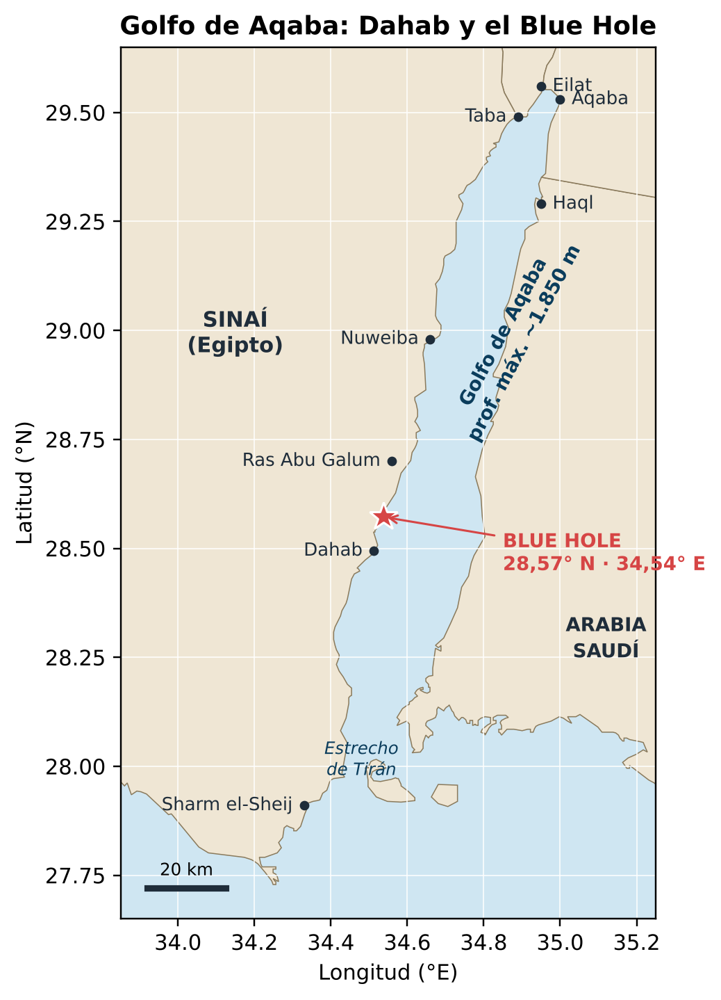

*Situación de Dahab en el mar Rojo y en el golfo de Aqaba. Ilustraciones propias con datos de costa de Natural Earth.*

El Blue Hole está en la costa este de la península del Sinaí (Egipto), unos 10 km al norte de Dahab, en el **golfo de Aqaba**: la rama nororiental del mar Rojo. El golfo es el extremo sur de la **falla transformante del mar Muerto** y llega a ~1.850 m de profundidad; por eso, a pocos metros de la orilla, el fondo cae en vertical.

### 4.1 Qué es un *blue hole*

Un **blue hole** («agujero azul») es una **dolina submarina**: un pozo vertical abierto en roca caliza o en arrecife. Se forma sobre todo durante las glaciaciones, cuando el nivel del mar estaba mucho más bajo. El agua de lluvia, algo ácida, disolvía la roca y excavaba cavidades. Al subir el mar, esas cavidades quedaron inundadas. Visto desde arriba es un círculo azul oscuro rodeado de arrecife turquesa, porque el agua profunda absorbe los demás colores.

### 4.2 Dimensiones del Blue Hole de Dahab

*Plano del Blue Hole de Dahab. Autor: Usellermann, CC BY-SA 3.0 / GFDL, vía Wikimedia Commons.*

| Elemento | Medida | Notas |
|---|---|---|
| **Diámetro** de la boca | ~70–80 m | En el techo del arrecife |
| **Fondo del pozo** | algo más de 100 m | Las fuentes dan entre 94 y 130 m |
| **The Saddle** («la silla») | ~6–7 m | Abertura somera hacia el mar abierto, la que usan los buceadores recreativos |
| **The Arch** («el Arco») | techo a ~52–56 m | Túnel que atraviesa el arrecife hacia mar abierto |
| **Longitud del Arco** | ~26 m | Visto desde dentro parece medir menos de 10 m |
| **Suelo del Arco** | de ~102 m a ~120 m | Desciende hacia el lado del mar |
| **Fuera del Arco** | escalones hasta ~800–1.000 m | Sin fondo útil como referencia |

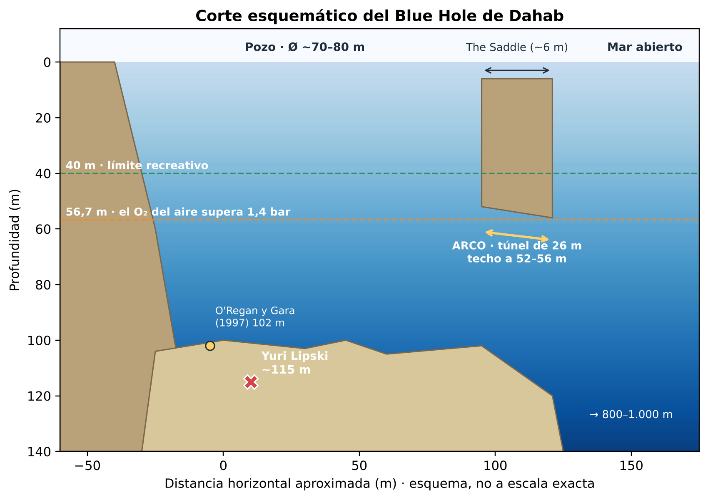
*Corte esquemático del Blue Hole. Ilustración propia.*

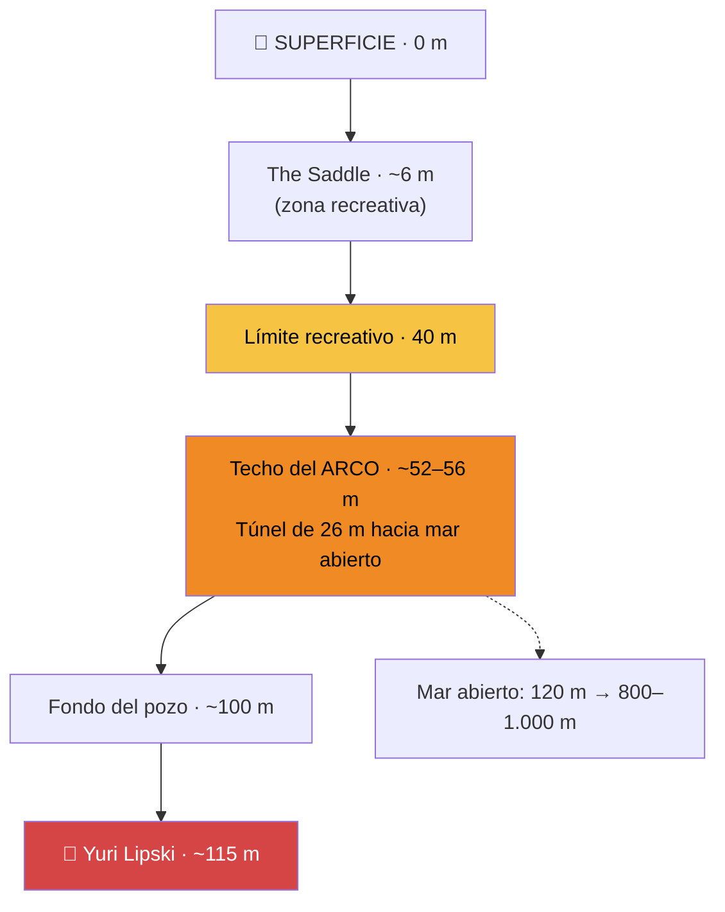

### 4.3 Por qué el Arco engaña

*Buceador técnico bajo el Arco del Blue Hole (2009). Foto: Tommi Salminen, CC BY-SA 3.0, vía Wikimedia Commons.*

1. **Es fácil pasarse.** La entrada no está en línea recta desde el pozo. Quien no la encuentra sigue bajando buscándola, y bajo el Arco no hay un fondo que sirva de referencia.
2. **Parece corto.** El agua es tan clara y la salida tan luminosa que el túnel parece de pocos metros, pero mide 26.
3. **Suele entrar corriente** desde el mar hacia el pozo. Nadar contra ella cuesta más tiempo y más gas.
4. **Es un «techo».** Mientras se está dentro no se puede subir en vertical (ver *entorno con techo* en el [glosario](#14-glosario-técnico)).
5. **Está justo pasado el límite del aire.** Con aire, el oxígeno empieza a ser peligroso hacia los 56–57 m (ver [§7.3](#73-toxicidad-del-oxígeno)), justo donde está el techo del Arco.

### 4.4 Historia breve del lugar

- La península del Sinaí estuvo bajo control israelí de **1967 a 1979**. En esa época el Blue Hole ganó fama internacional entre buceadores.
- En **1968**, un grupo de buceadores israelíes dirigido por Alex Shell lo exploró con equipo moderno y vio el Arco.
- Desde **1982** se bucea casi a diario. La inmersión recreativa clásica, *Bells to Blue Hole*, no pasa de 30 m y termina cruzando la Saddle a 7 m, sin acercarse nunca al Arco.

### 4.5 Qué vida marina encontramos

Lo que hace especial a Dahab no está en el fondo del pozo, sino en la **pared del arrecife entre 0 y 30 m**. La luz decide qué hay a cada profundidad: el agua absorbe primero el rojo (~5 m), luego el naranja, el amarillo y el verde; por debajo de ~40 m solo queda azul.

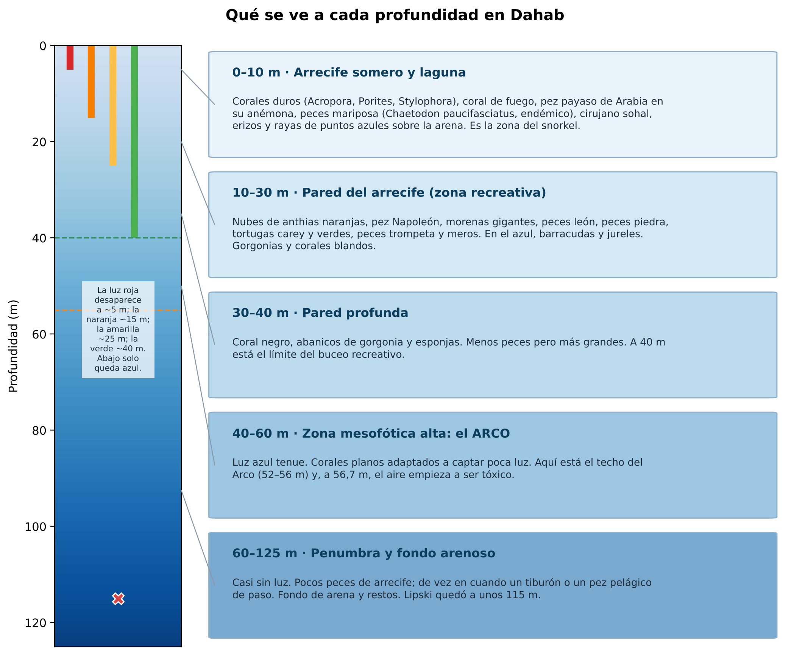

| Especie | Nombre científico | Profundidad | Curiosidad |
|---|---|---|---|
| Anthias | *Pseudanthias squamipinnis* | 3–30 m | Nubes naranjas sobre el coral; nacen hembras y algunas pasan a machos |
| Pez Napoleón | *Cheilinus undulatus* | 5–60 m | Puede superar 1,5 m; en peligro según la UICN |
| Pez payaso de Arabia | *Amphiprion bicinctus* | 1–30 m | Vive entre los tentáculos de una anémona |
| Pez mariposa del mar Rojo | *Chaetodon paucifasciatus* | 2–30 m | Endémico (solo vive en esta región) |
| Pez león / pez piedra | *Pterois miles* / *Synanceia verrucosa* | 0–50 m | Venenosos: mirar sin tocar |
| Tortugas carey y verde | *Eretmochelys imbricata*, *Chelonia mydas* | 1–40 m | Ambas amenazadas |
| Jardín de anguilas | *Gorgasia sillneri* | 10–40 m | Cientos de anguilas asomando de la arena (Eel Garden) |

Los corales del golfo de Aqaba resisten temperaturas que blanquean corales de otros mares. Se cree que sus antepasados colonizaron el mar Rojo entrando por el sur, donde el agua es muy caliente, y solo sobrevivieron los más resistentes: es el llamado **refugio térmico** (Fine et al., 2013; Bellworthy y Fine, 2021).

---

## 5. Cronología de la inmersión

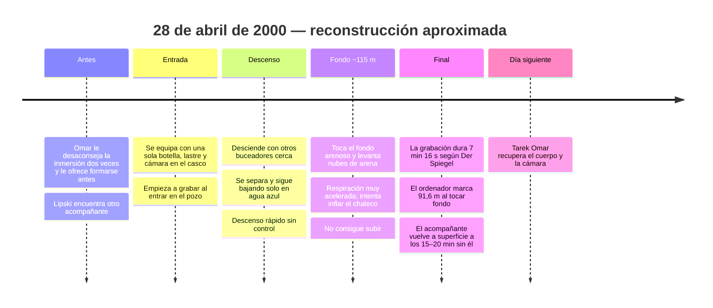

> ⏱️ **Ojo con las cifras de tiempo.** Lo único verificable es la duración de la grabación (unos 6–7 minutos). El resto de tiempos sale de testimonios indirectos.

---

## 6. Qué muestra la grabación

*(Descripción basada en las fuentes escritas que la analizan. Este estudio no enlaza el vídeo.)*

1. **Primeros minutos:** paredes de arrecife, otros buceadores, luz azul intensa.
2. **Separación:** los demás desaparecen del encuadre y solo queda agua azul. La luz baja.
3. **Descenso continuo:** no se ve ninguna parada para controlar la flotabilidad.
4. **Llegada al fondo:** la arena se levanta y nubla la imagen. Se oye una respiración cada vez más rápida.
5. **Fase final:** gestos de lucha, intento de inflar el chaleco. Según la descripción de Wikipedia, llega a **quitarse el regulador** de la boca. La cámara acaba mirando al fondo y la imagen queda quieta.

> 🔍 **Matiz importante:** varias fuentes señalan que la cinta **no muestra literalmente el instante de la muerte**, sino los minutos previos. El título «grabó su propia muerte» es, por tanto, una simplificación.

---

## 7. Por qué murió: análisis punto por punto

Nadie puede saber con certeza qué pasaba por su cabeza. Pero la física del buceo permite calcular **qué le hacía el aire a 115 m**. Los números de esta sección son cálculos propios, hechos con fórmulas estándar y comprobados con un script.

### 7.1 La presión (ley de Boyle)

En el mar, cada **10 m** de profundidad añaden **1 bar** de presión. A eso se suma 1 bar de la atmósfera.

$$P_{\text{absoluta}} = 1 + \frac{\text{profundidad (m)}}{10}$$

| Profundidad | Presión absoluta | Un litro de aire de superficie ocupa… |
|---|---|---|
| 0 m | 1 bar | 1 L |
| 10 m | 2 bar | 0,5 L |
| 40 m | 5 bar | 0,2 L |
| 56 m | 6,6 bar | 0,15 L |
| **115 m** | **12,5 bar** | **0,08 L** |

**Consecuencia:** a 115 m todo gas se comprime 12,5 veces. Esto afecta a tres cosas a la vez: el **consumo** de la botella ([§7.5](#75-consumo-de-gas-la-botella-se-vacía-12-veces-más-rápido)), el **chaleco** ([§7.6](#76-flotabilidad-por-qué-no-pudo-subir)) y el **neopreno** del traje.

### 7.2 Narcosis por nitrógeno («borrachera de las profundidades»)

El aire es un **79 % nitrógeno**. Según la **ley de Dalton**, cada gas de una mezcla aporta su parte de la presión total (su **presión parcial**). Según la **ley de Henry**, cuanto mayor es esa presión parcial, más gas se disuelve en la sangre y en los tejidos.

El nitrógeno disuelto a alta presión tiene un efecto **anestésico** sobre el sistema nervioso. Los efectos se parecen a los del alcohol: euforia, exceso de confianza, ideas fijas, lentitud y, a gran profundidad, alucinaciones y pérdida de conciencia.

- Una regla informal, la **«ley del Martini»**, compara cada 10 m por debajo de los 20 m con tomarse un martini.
- A 115 m: (115 − 20) / 10 ≈ **9–10 «martinis»**.
- Presión parcial de nitrógeno a 115 m: 0,79 × 12,5 ≈ **9,9 bar**, frente a los 0,79 bar de superficie.

> 🧠 **Por qué importa:** la narcosis **no duele ni avisa**. Quita justo la capacidad de darse cuenta del peligro. Su único remedio es **subir**, y subir era lo que Lipski no conseguía hacer.

### 7.3 Toxicidad del oxígeno

El oxígeno, imprescindible para vivir, es **tóxico** para el sistema nervioso central cuando su presión parcial (**ppO₂**) es demasiado alta. Puede provocar **convulsiones sin aviso previo**. Bajo el agua, una convulsión suele hacer que el buceador suelte el regulador y se ahogue.

- Límite de trabajo recomendado: **1,4 bar**. Límite máximo de contingencia: **1,6 bar**.
- La ppO₂ del aire a 115 m es 0,21 × 12,5 ≈ **2,6 bar**, **casi el doble del máximo**.
- **Profundidad máxima operativa (MOD)** del aire:
  - con 1,4 bar → 10 × (1,4 / 0,21 − 1) ≈ **56,7 m**
  - con 1,6 bar → ≈ **66 m**

> 💡 **Dato revelador:** el artículo de *Der Spiegel* (2012) fija en **56 m** el límite crítico del aire comprimido, y el techo del Arco está entre 52 y 56 m. El cálculo lo confirma: **el Arco está exactamente donde el aire empieza a volverse veneno.** Lipski estuvo unos 60 m más abajo.

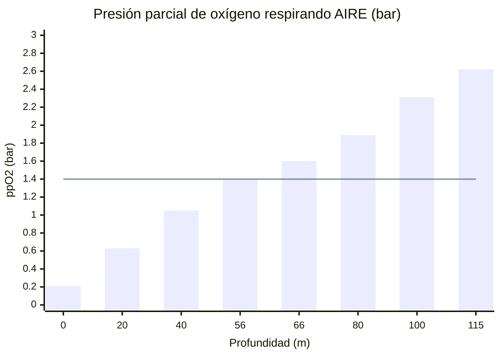

*Barras: ppO₂ del aire a cada profundidad. Línea: límite recomendado de 1,4 bar.*

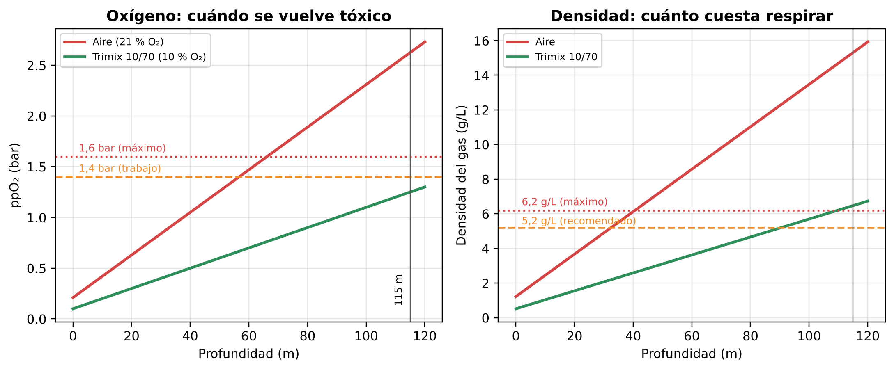
*Presión parcial de oxígeno y densidad del gas respirando aire o trimix 10/70. Cálculo propio.*

### 7.4 Densidad del gas y dióxido de carbono (CO₂)

Este factor se menciona poco en los vídeos de misterio, pero es de los más importantes. A 12,5 bar, el aire es **12,5 veces más denso**: unos **15 g/L**, frente a 1,2 g/L en superficie.

- Las recomendaciones de Anthony y Mitchell (2016) fijan como máximo deseable **5,2 g/L** y como máximo absoluto **6,2 g/L**. Con aire, esos límites se alcanzan hacia los **32 m** y los **41 m**.
- A 115 m, la densidad es **2,5 veces el máximo absoluto**.
- Un gas tan denso circula mal por las vías respiratorias. Cuesta mucho esfuerzo moverlo y el **CO₂ se acumula** (**hipercapnia**).
- El exceso de CO₂ produce **sensación de ahogo y ansiedad**, **intensifica la narcosis** y **hace más probable la toxicidad del oxígeno**.

> 🔄 **El círculo vicioso:** gas denso → el CO₂ se acumula → ahogo y pánico → respiración más rápida → más CO₂ y más gasto de aire → más pánico. Encaja con la respiración que describen quienes han analizado la grabación.

### 7.5 Consumo de gas: la botella se vacía 12 veces más rápido

| Situación | Consumo en superficie (SAC) | Consumo a 115 m | Duración de una botella de 12 L a 200 bar (2.400 L) |
|---|---|---|---|
| Buceador relajado | 20 L/min | 250 L/min | **≈ 9,6 min** |
| Esfuerzo o estrés | 40 L/min | 500 L/min | **≈ 4,8 min** |
| Pánico | 60 L/min | 750 L/min | **≈ 3,2 min** |

*Estimación propia. La capacidad real de su botella y su consumo no constan en ninguna fuente.*

**Conclusión:** aun llegando con la botella llena, no había gas suficiente para hacer las **paradas de descompresión** que exige una inmersión así. Ni siquiera alcanzaba para un ascenso lento.

### 7.6 Flotabilidad: por qué no pudo subir

Según Wikipedia, intentó inflar el chaleco pero no logró ascender. Varios factores físicos se suman en contra:

1. **Exceso de lastre.** Omar contó a *Der Spiegel* que llevaba unos **12 kg de plomo** en el cinturón, además de la botella de 12 L, la cámara y las baterías.
2. **El neopreno se aplasta.** El traje flota gracias a burbujas de gas en su interior. A 12,5 bar esas burbujas se comprimen y el traje pierde casi toda su flotabilidad, de modo que el buceador pesa bastante más que en superficie.
3. **Inflar el chaleco cuesta mucho gas.** Para compensar 12 kg hacen falta 12 L de gas **a 115 m**, es decir, unos **150 L de superficie** sacados de una botella que ya se vaciaba rápidamente.
4. **Fallo de procedimiento por narcosis.** La maniobra de emergencia correcta sería **soltar el cinturón de lastre**. Según la explicación atribuida a Omar, Lipski intentó llenar un chaleco que ya estaba lleno en lugar de soltar el lastre. Bajo narcosis y pánico es típico quedarse **fijado en una sola acción**.

> ⚖️ **Ojo con la trampa contraria:** si hubiera soltado el lastre, habría subido sin control. Eso significaba un ascenso rapidísimo desde 115 m y muy probablemente una **enfermedad descompresiva** grave o una **sobreexpansión pulmonar**. A esa profundidad, con ese equipo, **ninguna salida era segura**. Por eso el error decisivo estuvo **antes** de entrar al agua.

### 7.7 El factor humano

- **Solo:** sin compañero que lo sujetara, le pasara gas o lo subiera.
- **Prisa:** rechazó el entrenamiento que le ofrecieron porque no quería esperar.
- **Objetivo fijo:** la fama del lugar empuja a querer conseguir «la inmersión».
- **Exceso de confianza:** ser instructor le daba seguridad en un terreno que no era el suyo.

---

## 8. La cadena de errores

En seguridad se habla del **modelo del queso suizo**: un accidente rara vez tiene una sola causa. Ocurre cuando los agujeros de varias capas de protección se alinean.

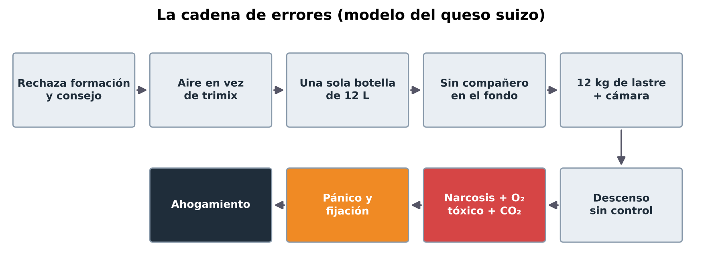

```mermaid
flowchart LR
    A["1️⃣ Planificación<br/>Rechaza la formación<br/>y el consejo de Omar"] --> B["2️⃣ Gas<br/>Aire en lugar de trimix"]
    B --> C["3️⃣ Equipo<br/>Una sola botella,<br/>sin gas de reserva"]
    C --> D["4️⃣ Sin compañero<br/>en el fondo"]
    D --> E["5️⃣ Lastre excesivo<br/>(~12 kg + cámara)"]
    E --> F["6️⃣ Descenso<br/>sin control"]
    F --> G["7️⃣ A 115 m:<br/>narcosis + O₂ tóxico<br/>+ CO₂ + gas denso"]
    G --> H["8️⃣ Pánico y<br/>fijación en el chaleco"]
    H --> I["💀 Ahogamiento"]
    style G fill:#d64545,color:#fff
    style I fill:#222,color:#fff
```

| Eslabón | ¿Comprobado? | Confianza |
|---|---|---|
| Rechazó el consejo de un experto | Sí (Omar en *The Guardian* y *CairoScene*) | 0,9 |
| Respiraba aire con una sola botella | Muy probable (Wikipedia lo da por supuesto) | 0,8 |
| Descenso sin control hasta ~115 m | Sí (grabación y profundidad del cuerpo) | 0,9 |
| Unos 12 kg de lastre | Testimonio directo de Omar en *Der Spiegel* | 0,8 |
| Narcosis severa | Físicamente inevitable a esa profundidad | 0,95 |
| Toxicidad del oxígeno como causa directa | Posible; no puede demostrarse | 0,5 |
| Acumulación de CO₂ | Muy probable por la densidad del gas | 0,8 |

---

## 9. La recuperación del cuerpo y de la cámara

- **Tarek Omar**, buceador técnico beduino que vive en Dahab desde 1989, recuperó el cuerpo **al día siguiente**, a petición de la familia.
- Junto al cuerpo encontró la **cámara**. Estaba diseñada para resistir **75 m** y había estado a 115 m, pero **seguía funcionando**.
- Cuando la madre pidió ayuda para desmontar el equipo, reprodujeron la cinta en su presencia. Omar ha dicho después que, de haber sabido que existía esa grabación, la habría destruido, porque lamenta que la madre tenga para siempre las imágenes de su hijo muriendo.
- La grabación acabó en internet. En 2014, *Atlas Obscura* informaba de que superaba los **8 millones de visitas**.

> 🧭 **Reflexión ética:** la grabación tiene valor formativo para buceadores, pero también es la muerte real de alguien con familia. Por eso este estudio no la enlaza.

### 9.1 Quién es Tarek Omar y cómo recupera los cuerpos

> En el vídeo de The Wild Project se le presenta como compañero de Lipski, pero **no buceó con él**: le desaconsejó la inmersión dos veces y, al día siguiente, bajó a recuperar su cuerpo.

| Aspecto | Dato |
|---|---|
| Origen | Beduino de la tribu Aulad Ali, nacido hacia 1965–66 cerca de la frontera con Libia |
| En Dahab | Llegó en 1989; aprendió a bucear en 1992; instructor desde 1995 |
| Primeras recuperaciones | 1997: Conor O'Regan y Martin Gara, abrazados a 102 m |
| Récord local | 209 m (*Der Spiegel*) o 220 m (*Al-Masry Al-Youm*) |
| Apodos | «Sheikh de los buceadores», «Rey del Blue Hole», «el recolector de huesos» |
| Escuela | Abrió el primer centro de buceo técnico de Dahab |
| Precio | No cobra; solo pide el coste del gas |

**Su método, según contó a *Der Spiegel* (2012):**

1. Averigua el equipo del fallecido (neopreno, lastre) para estimar cómo se hundió el cuerpo.
2. Pregunta al compañero dónde y a qué profundidad lo vio por última vez.
3. Su equipo avisa a los bañistas.
4. Baja y se deja derivar como lo haría un cuerpo inerte.
5. La mayoría de los cuerpos están entre 100 y 120 m. Lo sujeta o lo ata a su cuerpo: tiene unos **5 minutos** de fondo.
6. Sube con él hasta ~40 m y lo envía a superficie con un **globo de elevación** (el fallecido no necesita descompresión).
7. Él se queda hasta **~3 horas** haciendo paradas de descompresión, respirando **trimix** y gases de descompresión.

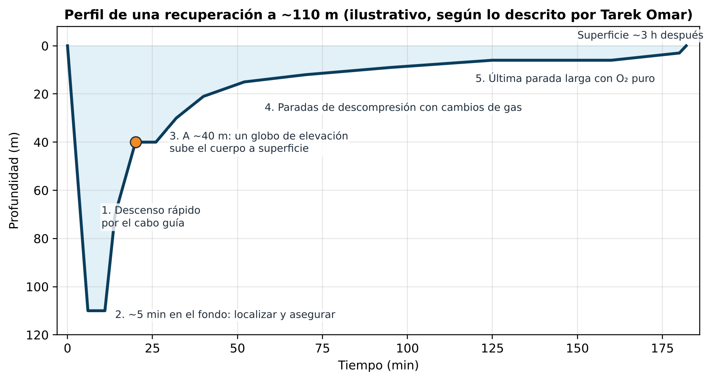

**Cómo debería hacerse según las buenas prácticas:** decidir primero si el riesgo compensa (no crear más víctimas), equipo con buceadores de apoyo en las paradas, gas con reservas, búsqueda ordenada desde el último punto conocido, globo dimensionado y soltado lejos del buceador, cortador a mano contra enredos y cámara hiperbárica preparada. La lección más dura es el caso de **Dave Shaw** (Sudáfrica, 2005): murió a 270 m intentando recuperar a otro buceador, enredado en los cabos y agotado por el esfuerzo con un gas muy denso. Todo esto está desarrollado en el PDF.

---

## 10. El «cementerio de buceadores»

*Placas en memoria de buceadores fallecidos, junto al Blue Hole (2011). Foto: D T G, CC BY 3.0, vía Wikimedia Commons.*

### 10.1 ¿Cuántos han muerto?

**No existe un registro oficial.** Las cifras publicadas varían mucho:

| Fuente | Cifra | Periodo |
|---|---|---|
| Tarek Omar en *Der Spiegel* (2012) | **más de 130** | 1997–2012 (unos 8 al año) |
| Comunidad local y prensa turística | hasta **200** | «en los últimos años» |
| *Undercurrent* (2017) | **al menos 40** buceadores con botella | desde 1980 |
| Placas en la costa (2012) | **14** placas | Solo los que tienen placa |

> 🧠 **Razonamiento:** las cifras más altas probablemente incluyen también muertes de **buceadores de superficie con tubo** (*snorkel*) por causas ajenas al Arco, que Wikipedia menciona. Lo prudente es decir «**más de un centenar, sin cifra oficial**».

### 10.2 Otros casos documentados

- **Conor O'Regan y Martin Gara** (Irlanda), de 22 y 23 años, murieron el 19 de noviembre de 1997. Omar encontró los cuerpos **abrazados a 102 m**. Su explicación: uno de ellos empezó a hundirse, el otro bajó a ayudarle y ambos perdieron el conocimiento. Fueron las primeras recuperaciones de Omar.
- Otras placas citadas por *Der Spiegel*: «James» (2003, 135 m) y «Andrei» (2004; a 170 m se vio equipo que podría ser suyo).
- **Stephen Keenan** (Irlanda, 39 años), buceador de seguridad de **apnea**, murió el **22 de julio de 2017**. Estaba asistiendo a la campeona italiana **Alessia Zecchini** en un intento de cruzar el Arco aguantando la respiración. Ella se desorientó, él llegó tarde al punto de encuentro, la rescató y la empujó a superficie, pero él no sobrevivió. Su historia la cuenta el documental de Netflix ***The Deepest Breath*** (2023).

### 10.3 Medidas que se tomaron

- La Cámara Egipcia de Buceo y Deportes Acuáticos coloca un **policía** en el Blue Hole para comprobar que los buceadores van con un guía titulado.
- Los centros locales exigen como mínimo una titulación **Tech 60** (buceo técnico hasta 60 m) para intentar el Arco.
- Aun así, *Der Spiegel* informaba en 2012 de que había guías dispuestos a llevar a alguien al túnel **sin preguntar a cambio de unos 100 €**.

---

## 11. Cómo se bucea el Arco de forma segura

*Buceador técnico con trimix en un pecio a 108 m (Toulon, Francia). Así se equipa quien baja a esas profundidades. Foto: Reginestein / Alexandre Hache, CC BY-SA 3.0, vía Wikimedia Commons.*

| Lo que hizo Lipski | Lo que hace un buceador técnico |
|---|---|
| Aire (21 % O₂, 79 % N₂) | **Trimix** (O₂ + helio + N₂), con menos nitrógeno para reducir la narcosis y menos oxígeno para evitar la toxicidad |
| Una sola botella | **Dos botellas en la espalda** más **botellas de etapa** (*stage*) y de **descompresión** |
| Sin plan de gas | **Planificación de gas** con reservas (regla de los tercios) |
| Solo | **Equipo de buceadores**, con un plan acordado y señales |
| Descenso libre en el azul | Descenso **controlado**, con **cabo guía** y referencia de profundidad |
| Sin descompresión | **Paradas de descompresión** planificadas con ordenador o tablas |
| Titulación recreativa | Titulación técnica (**Tech 60** o superior) y experiencia progresiva |

> Wikipedia señala que, para un buceador técnico bien equipado y competente, el Arco presenta **poca dificultad**. El lugar no es mortal en sí mismo: lo que mata es bucearlo **sin la formación y el equipo adecuados**.

*Chaleco compensador de flotabilidad tipo jacket, la pieza que Lipski intentaba inflar. Foto: Mark.murphy, dominio público, vía Wikimedia Commons.*

---

## 12. Mitos frente a realidad

| Mito | Realidad | Confianza |
|---|---|---|
| «Hay algo sobrenatural en el Blue Hole» | Omar lo niega: las causas son humanas y físicas | 0,95 |
| «Grabó el momento exacto de su muerte» | Grabó el descenso y los últimos minutos; el instante final no se ve con claridad | 0,7 |
| «Era un principiante» | Era instructor, pero no buceador técnico | 0,9 |
| «Se quedó sin oxígeno» | Lo más probable es que el problema fueran la narcosis, el CO₂ y el pánico, no solo el gas | 0,7 |
| «Llevaba una botella de oxígeno» | Llevaba **aire** comprimido. El oxígeno puro sería mortal a esa profundidad | 0,85 |
| «El Blue Hole es el lugar más peligroso del mundo» | El pozo es un punto de buceo normal; el peligro es el **Arco** bajo 50 m | 0,9 |
| «Han muerto 200 personas» | No hay registro oficial; las estimaciones van de 40 a 200 según el periodo y el criterio | 0,8 |
| «Al final del vídeo una anguila lo ataca» (teoría publicada en GitHub en 2019) | No hay ninguna confirmación. Se basa en interpretar una imagen muy oscura y probablemente es **pareidolia** (ver formas conocidas en manchas). Ninguna fuente seria la recoge | 0,9 de que es falsa |

---

## 13. Contraste de fuentes: datos que no coinciden

| Dato | Versión A | Versión B | Más probable y por qué |
|---|---|---|---|
| **Fecha** | 28 abril 2000 (Wikipedia, placa citada por *Der Spiegel*) | 8 abril 2000 (blog *A Little Bit Human*) | **28 de abril**: coinciden la fuente primaria y la placa |
| **Profundidad** | 115 m (Omar en *Der Spiegel*, Wikipedia) | 111 m (resumen de un vídeo); «algo más de 300 pies» (*Atlas Obscura*) | **~115 m**; 300 pies son 91 m, así que «algo más de» es compatible |
| **Techo del Arco** | 52 m (*Der Spiegel*) | 55–56 m (Wikipedia, *DeeperBlue*) | **52–56 m**: depende de dónde se mida |
| **Profundidad del pozo** | ~100 m (Wikipedia) | 94 / 110 / 120 / 130 m (webs turísticas) | **~100 m** dentro del pozo; más allá del Arco, mucho más |
| **Quién pidió recuperarlo** | La madre (Wikipedia, Omar) | El padre (*A Little Bit Human*) | **La madre**, según el propio Omar |
| **Cuándo se recuperó** | Al día siguiente (Wikipedia) | Unos dos días después (blog) | **Al día siguiente**, según Omar |
| **Muertes totales** | más de 130 en 15 años | hasta 200 / al menos 40 | **Más de 100, sin cifra oficial** |

---

## 14. Glosario técnico

| Término | Significado |
|---|---|
| **Apnea** (*freediving*) | Buceo aguantando la respiración, sin botella |
| **Arco** (*The Arch*) | Túnel de ~26 m que comunica el Blue Hole con el mar abierto, con el techo a ~52–56 m |
| **bar** | Unidad de presión. 1 bar ≈ la presión de la atmósfera al nivel del mar |
| **Blue hole** | Dolina submarina: pozo vertical en roca caliza o arrecife, inundado al subir el nivel del mar |
| **Botella de etapa** (*stage*) | Botella extra que lleva el buceador técnico colgada al costado, con gas para una fase concreta de la inmersión |
| **Buceo recreativo** | Buceo deportivo sin paradas de descompresión obligatorias, normalmente hasta 40 m como máximo |
| **Buceo técnico** | Buceo más allá de los límites recreativos: más de 40 m, gases especiales, descompresión obligatoria o entornos con techo |
| **Chaleco compensador** (BCD, *jacket*, *wing*) | Chaleco que se infla con gas de la botella para ajustar la flotabilidad |
| **CO₂ / hipercapnia** | Exceso de dióxido de carbono en sangre. Causa ahogo, ansiedad, confusión y, al final, pérdida de conciencia |
| **Densidad del gas** | Masa por litro de gas respirado (g/L). Aumenta con la profundidad y dificulta la respiración |
| **Descompresión** (paradas de) | Paradas durante el ascenso para que el gas disuelto en los tejidos salga poco a poco sin formar burbujas |
| **Dolina** | Depresión o pozo formado por la disolución de roca caliza |
| **Enfermedad descompresiva** (EDC, DCS, *bends*) | Lesiones por burbujas de gas en sangre y tejidos al ascender demasiado rápido |
| **Entorno con techo** (*overhead environment*) | Lugar donde no se puede subir en vertical: cuevas, pecios, túneles |
| **Heliox** | Mezcla de helio y oxígeno, sin nitrógeno |
| **Helio** | Gas inerte, ligero y casi sin efecto narcótico. Sustituye al nitrógeno en mezclas profundas |
| **Inflador** | Válvula que pasa gas de la botella al chaleco |
| **Lastre** | Pesos de plomo (cinturón o bolsillos) para compensar la flotabilidad del cuerpo y del traje |
| **Ley de Boyle** | A temperatura constante, el volumen de un gas es inversamente proporcional a su presión |
| **Ley de Dalton** | La presión total de una mezcla es la suma de las presiones parciales de cada gas |
| **Ley de Henry** | La cantidad de gas que se disuelve en un líquido es proporcional a su presión parcial |
| **«Ley del Martini»** | Regla informal: la narcosis equivale a un martini por cada 10 m por debajo de 20 m |
| **MOD** (profundidad máxima operativa) | Profundidad a partir de la cual la ppO₂ de una mezcla supera el límite seguro |
| **Narcosis por nitrógeno** | Efecto anestésico del nitrógeno a alta presión. Se parece a la embriaguez y desaparece al subir |
| **Neopreno** | Material del traje de buceo, con burbujas de gas que dan flotabilidad y aislamiento; se comprime con la profundidad |
| **Nitrox** | Aire enriquecido con más del 21 % de oxígeno. Sirve para profundidades moderadas, no para 115 m |
| **Pareidolia** | Tendencia del cerebro a ver formas conocidas (caras, animales) en imágenes difusas o aleatorias |
| **Presión absoluta** | Presión del agua más la de la atmósfera |
| **Presión parcial** (ppO₂, ppN₂) | La parte de la presión total que corresponde a un gas concreto de la mezcla |
| **Regulador** | Aparato que reduce la presión de la botella a la presión ambiente para poder respirar |
| **SAC** (*surface air consumption*) | Consumo de gas por minuto expresado en litros de superficie |
| **Saddle** | Abertura somera (~6 m) del Blue Hole hacia el mar, usada en las inmersiones recreativas |
| **Sobreexpansión pulmonar** | Rotura pulmonar por subir aguantando la respiración: el gas se expande al bajar la presión |
| **Tech 60** | Nivel de formación técnica para bucear hasta 60 m |
| **Toxicidad del oxígeno (SNC)** | Efecto tóxico del O₂ sobre el sistema nervioso central por encima de ~1,4–1,6 bar. Puede causar convulsiones |
| **Trimix** | Mezcla de oxígeno, helio y nitrógeno para inmersiones profundas |

---

## 15. Lecciones para cualquier buceador

1. **Bucea dentro de tu formación**, no de tu ego. Ser instructor recreativo no te convierte en buceador técnico.
2. **Nunca vayas solo** a profundidad, y menos en un sitio con techo o sin fondo.
3. **El aire tiene límite**: por la toxicidad del oxígeno, hacia 56–66 m. Por la densidad del gas, ya hacia 32–41 m.
4. **La narcosis no avisa.** Si notas algo raro, **sube unos metros**.
5. **Lastre justo.** Con exceso de lastre, cualquier problema de flotabilidad se convierte en una emergencia.
6. **Escucha a los expertos locales.** A Lipski le advirtieron dos veces.
7. **Planifica el gas** con reservas para lo imprevisto.
8. **La fama de un lugar no es una razón para bucearlo.**

---

## 16. Metodología, límites y nivel de confianza

**Cómo se ha hecho:**

1. Se ha dividido el caso en partes: hechos, lugar, física, fisiología, recuperación, contexto y mitos.
2. Cada dato se ha contrastado en al menos dos fuentes independientes cuando ha sido posible. Las discrepancias están en la [§13](#13-contraste-de-fuentes-datos-que-no-coinciden).
3. Los cálculos (presiones, ppO₂, MOD, densidad, consumo, flotabilidad) se han hecho con fórmulas estándar y se han comprobado con un script en Python.
4. Todo el texto es redacción propia: no copia párrafos de ninguna fuente y las fuentes se citan al final.
5. **Comprobación de originalidad (31/10/2026):** se buscaron en internet frases literales del documento y análisis parecidos, sin encontrar coincidencias. En GitHub solo existe una nota breve en inglés de 2019 (`shawwn/yuri`) con la teoría especulativa de la anguila. No se ha encontrado ningún análisis en español que reúna la física (ppO₂, densidad del gas, consumo, flotabilidad), el contraste de fuentes y el glosario.

**Límites:**

- No se ha podido ver el vídeo de The Wild Project ni la grabación original. La descripción procede de fuentes escritas.
- La causa exacta de la muerte **no se conoce con certeza**. No hay ninguna autopsia publicada.
- Los 12 kg de lastre y el fallo del chaleco llegan a través de fuentes secundarias que citan a *Der Spiegel*.
- Los cálculos de consumo son **estimaciones**: se desconocen el tamaño real de su botella y su consumo personal.

**Confianza global del estudio:**

| Bloque | Confianza |
|---|---|
| Hechos básicos (quién, cuándo, dónde, profundidad) | 0,9 |
| Física y fisiología (cálculos) | 0,95 |
| Reconstrucción de la secuencia exacta | 0,6 |
| Causa concreta de la muerte | 0,6 (multifactorial y probable, sin confirmar) |
| Cifras de víctimas del Blue Hole | 0,5 (sin registro oficial) |

---

## 17. Fuentes

**Fuentes principales**

- Wikipedia (en). *Blue Hole (Red Sea)*. https://en.wikipedia.org/wiki/Blue_Hole_(Red_Sea)
- Grossekathöfer, M. (13/07/2012). *A Visit to the World's Deadliest Dive Site*. **Der Spiegel**, reproducido por ABC News. https://abcnews.com/International/visit-worlds-deadliest-dive-site/story?id=16772927
- Ghoneim, N. (20/10/2016). *Egyptian Diver Tarek Omar: The Keeper of Dahab's Divers' Cemetery*. **CairoScene**. https://cairoscene.com/lifestyle/egyptian-diver-tarek-omar-the-keeper-of-dahab-s-divers-cemetery
- Bower, E. (26/08/2017). *Top diver's death casts long shadow over deep beauty of the Blue Hole*. **The Guardian**. https://www.theguardian.com/world/2017/aug/26/blue-hole-red-sea-diver-death-stephen-keenan-dahab-egypt
- *Atlas Obscura* / Slate (04/03/2014). *Diver's cemetery: the Blue Hole of Dahab*. https://www.slate.com/blogs/atlas_obscura/2014/03/04/diver_s_cemetery_the_blue_hole_of_dahab_on_the_red_sea_in_egypt.html

**Física y fisiología del buceo**

- Grossekathöfer, M. (13/07/2012). *The Blue Hole in the Red Sea Is the Deadliest Dive Site in the World*. **Der Spiegel International** (texto completo). https://www.spiegel.de/international/zeitgeist/the-blue-hole-in-the-red-sea-is-the-deadliest-dive-site-in-the-world-a-844099.html
- Al-Masry Al-Youm (2016) y Masrawy (2018): reportajes sobre Tarek Omar (en árabe).
- Bellworthy, J. y Fine, M. (2021). *Warming resistant corals from the Gulf of Aqaba…* PeerJ. https://pmc.ncbi.nlm.nih.gov/articles/PMC8005291/
- Wikipedia (en). *Red Sea*, *Gulf of Aqaba*, *Dahab*, *Dave Shaw*.
- Wikipedia (en). *Nitrogen narcosis*. https://en.wikipedia.org/wiki/Nitrogen_narcosis
- WorkSafe New Zealand. *Breathing oxygen and enriched mixtures while diving*. https://www.worksafe.govt.nz/about-us/news-and-media/breathing-oxygen-and-enriched-mixtures-while-diving/
- TDI. *Avoid CNS Oxygen Toxicity While Diving Nitrox*. https://www.tdisdi.com/tdi-diver-news/avoid-cns-oxygen-toxicity-while-diving-nitrox/
- Suunto. *Dive terms*. https://www.suunto.com/en-ph/Support/Product-support/suunto_d5/suunto_d5/reference/dive-terms/
- DDRC Healthcare. *Gas Density and SCUBA* (resume a Anthony y Mitchell, 2016). https://www.ddrc.org/gas-density-and-scuba/
- DAN. *Gas density for divers*. https://dan.org/?p=12020

**Contexto y otros casos**

- Wikipedia (en). *Stephen Keenan*. https://en.wikipedia.org/wiki/Stephen_Keenan
- DeeperBlue. *Freediver Stephen Keenan dies providing safety at Dahab Blue Hole*. https://www.deeperblue.com/freediver-stephen-keenan-dies-providing-safety-dahab-blue-hole
- Undercurrent (2017). *Dangerous dive site*. https://undercurrent.org/UCnow/dive_magazine/2017/DangerousDiveSite201709.html
- Showcaves.com. *Blue Hole, Dahab*. https://showcaves.com/english/eg/karst/Blue.html
- Outdoors Codidact. *Why didn't Yuri Lipski inflate his BCD?* https://outdoors.codidact.com/posts/57396

**Origen**

- The Wild Project. *He Recorded His Own DEATH Underwater: The Terrifying Case of Yuri Lipski* (30/10/2026). https://www.youtube.com/watch?v=qArQMyX28PA

---

## 18. Créditos de las imágenes

Todas las fotografías proceden de **Wikimedia Commons** y tienen licencias libres que permiten reutilizarlas citando al autor. Los diagramas (Mermaid) son de elaboración propia.

| Imagen | Autor | Licencia | Página original |
|---|---|---|---|
| Vista del Blue Hole | Gustavo Gerdel (2018) | CC BY-SA 4.0 | [Commons](https://commons.wikimedia.org/wiki/File:Dahab_Blue_Hole.jpg) |
| Plano del Blue Hole | Usellermann (2009) | CC BY-SA 3.0 / GFDL | [Commons](https://commons.wikimedia.org/wiki/File:Blue_Hole_map.png) |
| Buceador bajo el Arco | Tommi Salminen (2009) | CC BY-SA 3.0 | [Commons](https://commons.wikimedia.org/wiki/File:Dahab_Blue_Hole_Arc_2009.jpg) |
| Placas conmemorativas | D T G (2011) | CC BY 3.0 | [Commons](https://commons.wikimedia.org/wiki/File:EGYPT_Dahab_Blue_Hole_memorials.JPG) |
| Buceador con trimix | Reginestein / Alexandre Hache (2021) | CC BY-SA 3.0 | [Commons](https://commons.wikimedia.org/wiki/File:Plongeur_Trimix.jpg) |
| Chaleco compensador | Mark.murphy (2004) | Dominio público | [Commons](https://commons.wikimedia.org/wiki/File:Bcd_-_stab.JPG) |
| Mapas, corte, zonas de vida, gráficas y esquemas (`figs/`) | Óscar Ramírez Martín | CC BY-SA 4.0 | Elaboración propia; costas de Natural Earth (dominio público) |

> **Licencia de este documento:** texto y diagramas propios bajo **CC BY-SA 4.0** (obligatoria por las fotos CC BY-SA que incluye). Cada fotografía conserva la licencia de su autor.

---

*En memoria de quienes no volvieron del Blue Hole.*
